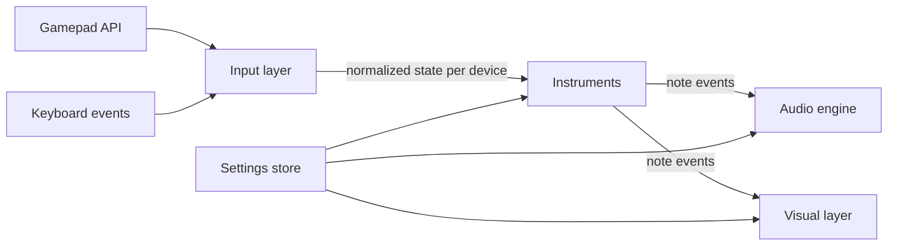

# Design – Music Sandbox

Status: draft, under discussion. Requirement IDs (R…) refer to [requirements.md](requirements.md).

## 1. Overview

The app is a single static page. Every frame it reads all input devices, turns raw button and axis changes into musical events per instrument, sends those events to the audio engine, and draws them.



Each layer only talks to the next through small, plain data objects, so instruments can be tested without audio or graphics, and the visuals never need to know what kind of device produced a note.

## 2. File structure

```
index.html
css/
  style.css
js/
  main.js                  App start-up, main loop, wiring
  input/
    gamepad-manager.js     Connect/disconnect, polling, edge detection
    detect.js              Controller type detection (R2.5)
    known-devices.js       VID:PID lists for guitars and drum kits
    mappings.js            Raw button/axis indexes -> logical controls
    keyboard-input.js      Keyboard events -> logical controls (R4c)
  instruments/
    instrument.js          Shared base: voice bookkeeping, event output
    guitar.js              Fret/strum logic (R4), also used for gamepad guitar/bass
    drums.js               Drum mapping and velocity (R4b)
    keys.js                Piano-style keyboard with sustain pedal (R4c)
  audio/
    audio-engine.js        AudioContext, master output, routing to sources
    pluck-worklet.js       Karplus-Strong plucked string (AudioWorklet) (R3.4)
    pluck-source.js        Main-thread wrapper for the worklet
    midi-source.js         Wrapper around webaudio-tinysynth (R3.3)
    theory.js              Note names, scales, MIDI note numbers
  visual/
    lanes.js               Layout of lanes side by side (R5.3)
    highway-view.js        Highway with notes travelling away (R5.2, R5.4)
    simple-view.js         Panel with lit buttons and note names (R5.2)
    keyboard-view.js       On-screen computer keyboard (R4c.5, R4c.6)
  ui/
    start-screen.js        "Click to start" and "press any button" prompts
    settings-panel.js      Per-controller advanced settings (R2.9)
    debug-view.js          Raw input view covering one lane (9.1)
  settings/
    store.js               Defaults, load/save in localStorage (R2.7)
  i18n/
    i18n.js                Loads language JSON files (R6.2)
lang/
  common.json              Words that are the same in every language
  en.json
  sv.json
vendor/
  webaudio-tinysynth/
    webaudio-tinysynth.js
    LICENSE
.github/workflows/
  pages.yml                Deploy to GitHub Pages (R7.3)
```

All code is ES modules loaded with `<script type="module">` (R7.1). For local testing the folder is served with any static file server, e.g. `python3 -m http.server`, because ES modules and AudioWorklets do not load from `file://`.

## 3. Input layer

### 3.1 Gamepads

- `gamepad-manager.js` listens for `gamepadconnected` and `gamepaddisconnected` and keeps one `Device` object per `gamepad.index`.
- Polling runs once per animation frame with `navigator.getGamepads()`. For each device it compares the new button/axis values with the previous frame and produces edges: `pressed`, `released`, and analog `changed`.
- Detection (`detect.js`) runs once on connect and returns `guitar`, `drumKit` or `gamepad`, following R2.5: XInput type in the id, then VID:PID against `known-devices.js`, then keywords. A stored manual choice for the same `gamepad.id` always wins (R2.6, R2.7).
- `mappings.js` translates raw indexes into logical controls, so instruments never see raw indexes:
  - Guitar: `fret1`…`fret5`, `strumUp`, `strumDown`, `whammy` (0..1), `tilt` (0..1), `start`, `back`.
  - Gamepad: `faceA/B/X/Y`, `shoulderL/R`, `triggerL/R` (0..1), `dpadUp/Down/Left/Right`, `start`, `back`.
  - The guitar mapping has a Linux (xpad) variant and a Windows (XInput) variant, since the indexes differ. The exact indexes for the Xplorer on Chrome/Linux must be confirmed with the real guitar (see 9.1).

### 3.2 Keyboard

- `keyboard-input.js` listens to `keydown`/`keyup` on `KeyboardEvent.code` (R4c.7) and ignores auto-repeat (`event.repeat`).
- It is only active when the keyboard instrument is enabled (R4c.2). While active it calls `preventDefault()` for `Space`, `Backspace`, `Alt` and all keys used for playing (R4c.8, R4c.10).
- It exposes the same kind of logical controls: `fret1`…`fret5`, `strum` (Backspace), `note:<code>`, `sustain` (Space), `octaveUp` (Shift), `octaveDown` (Alt).
- It is treated as one extra device in the lane list, shown last.

## 4. Instruments

An instrument receives the logical edges of one device each frame and emits note events. It also owns the bookkeeping of which notes are ringing.

### 4.1 Note events

```js
{ type: 'noteOn',  voiceId, midi, velocity, time }
{ type: 'noteOff', voiceId, fade, time }      // fade in seconds (R4.3.1)
{ type: 'bend',    semitones, time }          // whole instrument
{ type: 'volume',  gain, time }               // whole instrument
```

`voiceId` is unique per sounding note, so the audio engine and the highway can follow the same note from start to end (R5.4).

### 4.2 Guitar (`guitar.js`)

Per fret it keeps: `held` (button down), `voiceId` of its ringing note (or none), and `heldSinceStrum` (whether the button has stayed down since it last sounded).

- Strum (up or down edge): for every fret that is held, if it has a ringing note from a previous strum, stop that voice and start a new one (R4.4); otherwise start a new one. Frets that are not held are untouched and keep ringing (R4.6). Several held frets sound together as a chord (R4.8).
- Fret press-down: if that fret has a ringing note, send `noteOff` with the short fade (R4.3, R4.3.1).
- Fret release: nothing; the note keeps ringing and decays on its own (R4.2, R4.7).
- Notes come from `theory.js`: scale and root from settings, default E minor pentatonic, fret 1 to 5 = E, G, A, B, D (R4.9). Bass is the same logic one octave lower with a bass sound (R2.10).
- Whammy and tilt are turned into `bend` and `volume` events. Which control drives which is a setting with a default to be decided after testing (R4.5).
- Start opens the settings panel for this device (R4.10). Back stops all voices with the soft fade (R4.11).
- On a regular gamepad in guitar mode, the mapping gives four face buttons plus one shoulder button as frets and D-pad up/down as strum (R2.10).

### 4.3 Drums (`drums.js`)

- Each logical button maps to a General MIDI drum note (channel 10), e.g. kick 36, snare 38, closed hi-hat 42, tom 45, crash 49, ride 51 (R4b.1).
- Digital buttons use a fixed velocity. Triggers fire when they pass a threshold, with velocity from how far they were pressed at that moment (R4b.1).
- Drum notes are one-shot: `noteOn` only; the sound ends by itself.

### 4.4 Keys (`keys.js`)

- Maps `KeyboardEvent.code` to MIDI notes with the musical typing layout (R4c.4), plus the octave offset from Shift/Alt at the moment the key is pressed (R4c.8).
- Key up sends `noteOff` with a short release, unless the sustain pedal is down; then the note is marked as sustained and stopped when the pedal is released (R4c.9, R4c.10).
- The `1`–`5` and Backspace keys are passed to an internal guitar instance (R4c.3).

## 5. Audio engine

- One `AudioContext` with `latencyHint: 'interactive'`. Browsers only allow audio to start after a click or key press, and a gamepad button does not count. The start screen therefore asks for one click or key press before anything else (see 7.1).
- Each instrument gets its own gain node (for `volume` events) feeding a master gain and a light limiter (`DynamicsCompressorNode`) to avoid clipping when many notes ring.
- Two source types, chosen per instrument (R3.5):
  - **Pluck source** (`pluck-worklet.js`): an AudioWorklet that runs one Karplus-Strong string per voice. Pitch bend changes the delay length smoothly; `noteOff` applies a fast gain ramp of `fade` seconds. Decay length and brightness are parameters in the settings.
  - **MIDI source** (`midi-source.js`): wraps webaudio-tinysynth, one MIDI channel per instrument, connected into the instrument's gain node. `bend` becomes a pitch-bend message and `noteOff` becomes a note-off.
- Default sources: guitar and bass use the pluck source; drums and keyboard use the MIDI source (drum kit and Acoustic Grand Piano) (R3.5, R4c.11).

## 6. Visual layer

- Drawing uses one `<canvas>` with the 2D API for all lanes, redrawn every animation frame. Settings and prompts are normal HTML on top.
- `lanes.js` splits the width into one lane per device, side by side, each with its own color and the controller number above it (R5.3, R5.3.1). The keyboard lane uses the label "Keyboard".
- **Highway view** (`highway-view.js`): a lane is drawn in perspective with five columns. A `noteOn` creates a note mark at the near end; it moves away into the distance at a constant speed. While the voice rings, a trail connects the note mark to the near end, with opacity following the voice's current level, and ends when the voice stops (R5.2, R5.4). Notes older than the visible length are dropped.
- **Simple view** (`simple-view.js`): the lane shows the device's buttons, lit while pressed, and the names of ringing notes (R5.1, R5.2).
- The visual style is a global setting; per-lane override can come later if needed.
- `keyboard-view.js` draws the on-screen keyboard when the keyboard instrument is enabled, with note names on the playing keys and lit keys while pressed (R4c.5, R4c.6).
- To show fading trails, the audio engine keeps a simple per-voice level estimate (envelope model) on the main thread instead of reading audio data back.

## 7. User interface

### 7.1 Start screen

1. "Click or press a key to start" (unlocks audio).
2. "Press any button on a controller" until at least one gamepad is seen (R2.8). The keyboard instrument can be turned on here too.
3. New controllers can be connected at any time; a lane is added when they appear and removed when they disconnect.

### 7.2 Settings panel

- A global part: visual style, keyboard instrument on/off, language.
- A per-device part (R2.9), opened from a small button above each lane or with Start on the guitar: instrument type, sound source, MIDI program, key and scale, whammy/tilt assignment, fade time, decay, button-to-sound mapping for drums, and a button that opens the device's debug view (9.1).
- Every setting has a default; the panel is never needed to start playing.

## 8. Settings, storage and language

- `store.js` keeps defaults in one object and saves user changes in `localStorage`, global settings under one key and per-device settings keyed by `gamepad.id` (R2.7). Unknown or missing values fall back to defaults, so new settings never break old saved data.
- `i18n.js` loads `lang/common.json` plus `lang/<lang>.json`, chosen from the setting or `navigator.language`, with English as fallback (R6.2). UI code only uses text keys, never literal strings.

## 9. Testing

### 9.1 Hardware check with the Xplorer

Before the guitar mapping is final, we need to see the raw input. Each device's advanced settings panel has a **Debug view** button. It opens a debug view that covers exactly that device's lane (e.g. half the screen with two controllers connected), so other lanes keep working. It shows `gamepad.id`, the detected type, the parsed VID:PID, and the live value of every raw button and axis, plus the logical controls they map to. A close button returns to the normal lane. With it we confirm on Chrome/Linux:

- the id string and VID:PID,
- the button indexes of the five frets, strum up/down, Start and Back,
- the whammy axis range and whether tilt is gradual or on/off (R4.5).

### 9.2 Logic tests

Instrument logic is pure (logical edges in, note events out), so `guitar.js`, `drums.js` and `keys.js` get small browser-run test pages under `tests/` that feed scripted edge sequences and check the events, e.g. "strum twice without release gives two noteOn and one noteOff". `tests/` is excluded from deployment.

## 10. Deployment

`.github/workflows/pages.yml` runs on pushes to the main branch. It copies only `index.html`, `css/`, `js/`, `lang/` and `vendor/` into a `_site` folder with plain shell commands, then publishes it with the official `actions/upload-pages-artifact` and `actions/deploy-pages` actions. No Node.js build step is involved (R7.3).

## 11. Open design questions

- Default assignment of whammy and tilt to pitch and volume (R4.5), decided after the hardware check.
- Exact Xplorer button and axis indexes on Chrome/Linux (9.1).

## 12. Milestones

1. **Input and debug.** Start screen (7.1), gamepad connect/disconnect and polling (3.1), controller type detection (R2.5), lanes side by side with controller numbers (R5.3, R5.3.1), a minimal settings panel per device with the debug view (9.1), settings store and i18n skeleton (8). Goal: connect the Xplorer and read its real id, buttons and axes on Chrome/Linux.
2. **Guitar sound.** Final guitar mapping from the milestone 1 findings, guitar logic (4.2), audio engine with the pluck source (5), simple view (6).
3. **More instruments.** Drums and MIDI source (4.3, 5), gamepad guitar/bass modes (R2.10), keyboard instrument and on-screen keyboard (3.2, 4.4).
4. **Highway and settings.** Highway view with sustain trails (R5.2, R5.4), full advanced settings (7.2), whammy/tilt assignment (R4.5).
5. **Deployment.** GitHub Pages workflow (10), logic test pages (9.2).

