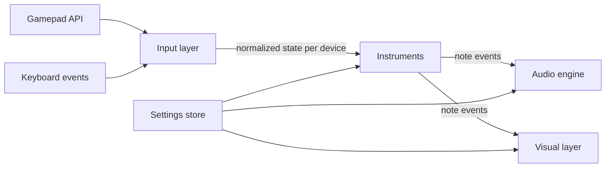

# Design – GarageBox - Music Sandbox

Status: milestones 1-5 implemented; decisions marked *provisional* wait for the owner's review. Requirement IDs (R…) refer to [requirements.md](requirements.md).

## 1. Overview

The app is a single static page. Every frame it reads all input devices, turns raw button and axis changes into musical events per instrument, sends those events to the audio engine, and draws them.



Each layer only talks to the next through small, plain data objects, so instruments can be tested without audio or graphics, and the visuals never need to know what kind of device produced a note.

## 2. File structure

```
README.md
docs/                      Requirements and design (not published)
tests/                     Logic test pages (not published)
src/                       The app; only this folder is published
  index.html
  css/
    style.css
  js/
    main.js                  App start-up, main loop, wiring
    input/
      gamepad-manager.js     Connect/disconnect, polling, edge detection
      detect.js              Controller type detection (R2.5)
      known-devices.js       VID:PID lists for guitars and drum kits
      mappings.js            Raw button/axis indexes -> logical controls
      keyboard-input.js      Keyboard events -> logical controls (R4c)
      back-hold.js           Back tap vs. 5 s / 10 s hold timing (R4.11 – R4.11.3)
    instruments/
      instrument.js          Shared base: voice bookkeeping, event output
      guitar.js              Fret/strum logic (R4), also used for gamepad guitar/bass
      drums.js               Drum mapping and velocity (R4b)
      keys.js                Piano-style keyboard with sustain pedal (R4c)
      setup.js               Builds an instrument and its sound config from settings
    audio/
      audio-engine.js        AudioContext, master output, routing to sources
      effects.js             guitar effects chain: drive, cabinet, echo, reverb (R3.6)
      pluck-worklet.js       Karplus-Strong plucked string (AudioWorklet) (R3.4)
      pluck-source.js        Main-thread wrapper for the worklet
      bass-source.js         Generated bass sound (R3.4.1)
      midi-source.js         Wrapper around webaudio-tinysynth (R3.3)
      theory.js              Note names, scales, MIDI note numbers
    visual/
      lanes.js               Layout of lanes side by side (R5.3)
      star-power.js          Star power trigger and confetti/light effect (R5.5)
      highway-view.js        Highway with notes travelling away (R5.2, R5.4)
      simple-view.js         Panel with lit buttons and note names (R5.2)
      keyboard-view.js       On-screen computer keyboard (R4c.5, R4c.6)
    ui/
      start-screen.js        "Click to start" and "press any button" prompts
      settings-panel.js      Per-controller advanced settings (R2.9)
      debug-view.js          Raw input view covering one lane (9.1)
      menu-nav.js            Gamepad navigation of the menus (7.4)
    settings/
      store.js               Defaults, load/save in localStorage (R2.7)
    i18n/
      i18n.js                Loads language JSON files (R6.2)
  lang/
    common.json              Words that are the same in every language
    en.json
    sv.json
  vendor/
    webaudio-tinysynth/
      webaudio-tinysynth.js
      LICENSE
.github/workflows/
  pages.yml                Deploy to GitHub Pages (R7.3)
```

All app code lives in `src/` and is ES modules loaded with `<script type="module">` (R7.1). Tests in `tests/` import modules from `../src/`. For local testing the repository root is served with any static file server, e.g. `python3 -m http.server`, because ES modules and AudioWorklets do not load from `file://`.

## 3. Input layer

### 3.1 Gamepads

- `gamepad-manager.js` listens for `gamepadconnected` and `gamepaddisconnected` and keeps one `Device` object per `gamepad.index`.
- Polling runs once per animation frame with `navigator.getGamepads()`. For each device it compares the new button/axis values with the previous frame and produces edges: `pressed`, `released`, and analog `changed`.
- Detection (`detect.js`) runs once on connect and returns `guitar`, `drumKit` or `gamepad`, following R2.5: XInput type in the id, then VID:PID against `known-devices.js`, then keywords. A stored manual instrument choice for the same detected type and slot always wins (R2.6, R2.7).
- `mappings.js` translates raw indexes into logical controls, so instruments never see raw indexes:
  - Guitar: `fret1`…`fret5`, `strumUp`, `strumDown`, `dpadLeft`, `dpadRight`, `whammy` (0..1), `tilt` (0..1), `start`, `back`. On the Xplorer the D-pad up/down *is* the strum bar (same raw buttons B12/B13), so there is no separate `dpadUp`/`dpadDown`; D-pad left/right (B14/B15 in `guitar-standard`, hat axis 6 in `guitar-xpad`) change values in the menus (7.4), do the D-pad action (R4.15, 4.2) during play on guitar and bass, and are two extra pads when the guitar is set to drums.
  - Analog controls also get an on/off ("pressed") state, used for display (the device information view and the outline of the control pills in the simple view), for the `pressed`/`released` edges and, for `tilt`, as the star power trigger (6, R5.5); no instrument plays notes on it, and tilt range shifting (4.2) uses the smoothed value, never this on/off state. An analog control counts as pressed above 0.5 of its 0..1 range, except `tilt`, which counts as pressed only at 0.9 or more (raw axis −0.8 or lower on the Xplorer, where the axis falls when the neck is raised), so that ordinary playing angles do not show as pressed.
  - Gamepad: `faceA/B/X/Y`, `shoulderL/R`, `triggerL/R` (0..1), `dpadUp/Down/Left/Right`, `start`, `back`.
  - The guitar mapping has a variant for browsers that apply the W3C "standard" mapping (`guitar-standard`: Chrome on Windows via XInput, and Chrome on Linux, which reports the Xplorer as `STANDARD GAMEPAD`) and a raw Linux (xpad/evdev) variant (`guitar-xpad`), since the indexes differ. `guitar-standard` is confirmed with the real Xplorer on Chrome/Linux (see 9.1), including D-pad left/right; `guitar-xpad` is still a best guess.

### 3.2 Keyboard

- `keyboard-input.js` listens to `keydown`/`keyup` on `KeyboardEvent.code` (R4c.7) and ignores auto-repeat (`event.repeat`).
- It is only active when the keyboard instrument is enabled (R4c.2). While active it calls `preventDefault()` for `Space`, `Backspace`, `Alt`, `Numpad0`–`Numpad9` and all keys used for playing (R4c.8, R4c.10, R4c.14). In Drums mode (R4c.12) `Space`, `Backspace`, `Alt`, `Shift` and `1`–`5` play nothing, but their default action is still prevented so the page does not scroll or jump.
- It exposes the same kind of logical controls: `fret1`…`fret5`, `strum` (Backspace), `note:<code>`, `sustain` (Space), `octaveUp` (Shift), `octaveDown` (Alt), and `pad:<code>` for `Numpad0`–`Numpad9` (by `code`, so NumLock does not matter; the numpad's other keys stay unused).
- It is treated as one extra device in the lane list, shown last (`KeyboardDevice`, id `computer-keyboard`, with the same `controls`/`controlEdges` interface as a gamepad device). It has no debug view, since it has no raw buttons or axes.
- Keys typed into form fields (the settings panel's selects) and keys pressed together with Ctrl or Meta are left to the browser. When the window loses focus, all keys count as released, so no note hangs. The top bar controls give the focus back after a change so playing continues right away.

## 4. Instruments

An instrument receives the logical edges of one device each frame and emits note events. It also owns the bookkeeping of which notes are ringing.

### 4.1 Note events

```js
{ type: 'noteOn',  voiceId, midi, velocity, time, glide?, hold? }  // glide: semitones from midi (R4.14), only while gliding; hold: started by a strum that is still held (R4.7.2)
{ type: 'holdEnd', voiceId, time }           // the strum bar of a held voice was released: its decay starts now (R4.7.2)
{ type: 'glide',   voiceId, semitones, time } // one voice's pitch offset from its noteOn midi (R4.14)
{ type: 'noteOff', voiceId, fade, time }      // fade in seconds (R4.3.1)
{ type: 'bend',    semitones, time }          // whole instrument (whammy)
{ type: 'volume',  gain, time }               // whole instrument (whammy set to volume)
{ type: 'action',  action, time, ... }        // UI only, never sent to the audio engine
```

`voiceId` is unique per sounding note, so the audio engine and the highway can follow the same note from start to end (R5.4).

`action` events: `openSettings` (Start, R4.10), `tiltToggled` (`{ enabled, steps, base }`, Back, R4.11; see 4.2), `resetSettings` (`{ full }`: `false` = Back held 5 s, R4.11.2; `true` = held 10 s, R4.11.3), `rangeShifted` (`{ base, steps }`, D-pad octave shift, R4.15) and `dpad` (`{ dir }`, −1 left / +1 right, D-pad action effect, key or sound, R4.15).

### 4.2 Guitar (`guitar.js`)

Per fret it keeps: `held` (button down) and the `voiceId` of its ringing note (or none). (An earlier draft also had `heldSinceStrum`; it turned out not to be needed, because R4.4 simply restarts the note on every strum.)

- Within one frame, fret edges are processed before strum edges, so pressing a fret and strumming in the same frame mutes the old note and plays a new one. Strum up and strum down in the same frame count as one strum.
- Strum (up or down edge): for every fret that is held, if it has a ringing note from a previous strum, stop that voice and start a new one (R4.4); otherwise start a new one. Frets that are not held are untouched and keep ringing (R4.6). Several held frets sound together as a chord (R4.8).
- Fret press-down: if that fret has a ringing note, send `noteOff` with the short fade (R4.3, R4.3.1).
- **Strum hold** (R4.7.2): the guitar keeps `strumsDown`, the set of strum controls (`strumUp`, `strumDown`) currently pressed (a press edge adds, a release edge removes), and `heldVoices`, the voice ids started by strums while the bar is held. Every voice started by a strum gets `hold: true` on its `noteOn` and goes into `heldVoices`. When `strumsDown` becomes empty (after the edges of a frame), the guitar sends `{ type: 'holdEnd', voiceId, time }` for every id in `heldVoices` and clears it. A press and release in the same frame (a quick strum) therefore sends `noteOn` with `hold` and `holdEnd` at the same time, which sounds as without hold. A voice that is muted (fret press), restrummed (R4.4, also by the other strum direction while one is held), dropped by `_muteAll` or a reset is removed from `heldVoices` without a `holdEnd` (it already got its `noteOff`); its replacement from a restrum is held again. Tap-to-play notes never carry `hold`. `releaseStrumHold(time)` sends the pending `holdEnd`s and clears both sets; `main.js` calls it on the lane's instrument (when it has the method) in every frame in which a controller menu owns the lane's directions, together with `cancelBackHold()` (7.4; it does nothing when nothing is held), so a hold never outlives the opening of a menu and the strum release that follows in the menu does nothing. The `hold` flag is sent for every source; only the pluck and bass sources use it (the MIDI source ignores `hold` and `holdEnd`). The gamepad guitar mode (strum = D-pad up/down) and the keyboard's guitar keys (Backspace, auto-repeat filtered by `KeyboardDevice`) go through the same code.
- Fret release: nothing; the note keeps ringing (R4.2) and, depending on the sound, dies away on its own or (sustaining MIDI program) keeps sounding until muted (R4.7). The guitar sends no `noteOff` for a fret release, so for the MIDI source the note is "held" until a mute, restrum or reset.
- Notes come from `theory.js`: scale and root from settings, default E minor pentatonic, fret 1 to 5 = E3, G3, A3, B3, D4 (MIDI 52, 55, 57, 59, 62) (R4.9). Other keys are placed at most half an octave from E3 (B2-A#3), so changing the key never jumps by almost an octave. Scales with more than five notes play their first five notes; the blues scale (six notes) plays its first five. Bass is the same logic one octave lower (E2 = 40) with a bass sound (R2.10). The per-controller setting `octave` (−1 Low, 0 Middle = default, +1 High) shifts all fret notes by 12 semitones per step after the key and scale are applied, for guitar and bass alike (R4.13).
- **Whammy** (R4.5): turned into `bend` or `volume` events by the per-device setting `whammy`: `bend` (default), `volume` or `off`. The deflection is the whammy value 0..1 as it is (0 = at rest).
  - Pitch bend: `semitones = deflection × bendRange`. `bendRange` default −2 semitones (a whole tone down at full whammy, like a real whammy bar, which slackens the strings); number field in semitones, range −24 … +24, step 1; 0 = no bend.
  - Volume: `gain = 0.5 + 0.5 × deflection` (`VOLUME_MIN` 0.5), i.e. half volume at rest, full volume pressed all the way.
  - Off: no `bend`/`volume` change (bend 0, gain 1).
  - A `bend` or `volume` event is only sent when the value changed by more than 0.001 since the last one sent (and once after every `configure`, so a new assignment takes effect at once). The tilt never produces `bend` or `volume` events; there is no tilt assignment setting and no vibrato. An old stored `tilt` assignment value is ignored.
- **Tilt smoothing** (R4.5.1): the raw mapped tilt (0..1) is smoothed with a time-based exponential moving average: each frame `smoothed += (raw − smoothed) × (1 − e^(−dt/τ))`, where `dt` is the time since the last reading and `τ` the smoothing time; the first reading, or `τ` = 0, is taken as is. This works the same at any frame rate, needs no buffer, and gives about the same delay as averaging the last 10 readings at 60 fps when `τ` is 80 ms. The setting `tiltSmoothing` is a number field in ms (0 = off, default 80, range 0–1000, step 10). The smoothing runs every frame whether tilt range shifting is on or off, so turning it on captures a settled value. The simple view's tilt pill shows the smoothed value; the debug view shows the raw axis.
- **Tilt range shifting** (R4.5.2 – R4.5.7). Constants in `guitar.js`: `TILT_STEP_SIZE = 0.1` (smoothed tilt change per step), `TILT_STEP_HYSTERESIS = 0.2` (steps), `STEP_LIMIT_OCTAVES = 3`, `TILT_STARTS_ENABLED = false`.
  - State per `Guitar` instance (only `stepBase` is saved, as `rangeOffset`): `tiltEnabled` (starts `false`, also after a reload or when the instrument is rebuilt, e.g. after an instrument change), `stepBase` (the locked range offset in steps, from the setting `rangeOffset`), `tiltRef` (the smoothed tilt when tilt was turned on, or `null`) and `tiltDelta` (whole steps added by the tilt).
  - Scale basis: the guitar options carry `rootMidi` (the note of fret 1 at offset 0, after key, bass octave and the `octave` setting are applied, i.e. `notes[0]`) and `scale`, the full interval list of the chosen scale in semitones from the root (e.g. minor pentatonic `[0, 3, 5, 7, 10]`, major `[0, 2, 4, 5, 7, 9, 11]`, blues six notes), not only the first five notes. `shiftInScale(root, scale, degree, steps)`: `d = degree + steps`, `n = scale.length`, result `root + scale[((d mod n) + n) mod n] + 12 × floor(d / n)`.
  - `noteFor(i, steps = rangeSteps())`: at steps 0 the normal fret note `notes[i]`; otherwise `shiftInScale(rootMidi, scale, i, steps)` clamped to MIDI 0..127. `i` may be outside 0..4 (the note strip asks for a 6th label, R5.7).
  - `stepLimit() = STEP_LIMIT_OCTAVES × scale.length` (15 for a pentatonic, 18 for blues, 21 for a seven-note scale, 36 for a twelve-note scale, which is why the stored value is limited to ±36).
  - Each frame while tilt is on, after smoothing: if `tiltRef` is `null` (no reading yet when tilt was turned on) it becomes the current smoothed value; `x = (smoothed − tiltRef) / TILT_STEP_SIZE`; `tiltDelta = stepDelta(x, tiltDelta)`, where `stepDelta(x, current)` keeps `current` while `|x − current| ≤ 0.5 + TILT_STEP_HYSTERESIS` and otherwise returns `round(x)`; then `tiltDelta` is clamped so `stepBase + tiltDelta` stays within `±stepLimit()`. Examples: `stepDelta(0.6, 0) = 0`, `stepDelta(0.75, 0) = 1`, `stepDelta(1.3, 1) = 1`, `stepDelta(0.35, 1) = 1`, `stepDelta(0.25, 1) = 0`, `stepDelta(−0.8, 0) = −1`, `stepDelta(2.9, 0) = 3`. The hysteresis of 0.2 step equals 0.02 of the tilt range.
  - `rangeSteps() = clamp(stepBase + (tiltEnabled ? tiltDelta : 0), ±stepLimit())`. New notes (`_play`, strum and tap-to-play) use `noteFor(i)` at that moment; ringing notes keep the `midi` they were started with (R4.5.4) unless tilt glide is on (R4.14). Muting a fret (R4.3) works by `voiceId`, so it is not affected by the range.
  - Back (R4.11 – R4.11.3) goes through a `BackHold` (`input/back-hold.js`, pure, times in seconds; `BACK_HOLD_SECONDS = 5`, `BACK_FULL_RESET_SECONDS = 10`, both counted from the press; comparisons use a tolerance of 1e-9). State: the press time (or `null`) and `level`, the highest tier already reported for this press (0 none, 1 `'hold'`, 2 `'fullReset'`).
    - `press(t)` remembers the press time and sets `level = 0`.
    - `update(t)` (every frame while a press is pending): if held ≥ 10 s and `level < 2`, sets `level = 2` and returns `'fullReset'`; else if held ≥ 5 s and `level < 1`, sets `level = 1` and returns `'hold'`; else `null`. So with a frame at least every few seconds it returns `'hold'` once at 5 s and `'fullReset'` once at 10 s; if a single frame jumps past 10 s with nothing reported (e.g. a suspended tab), it returns only `'fullReset'`, which includes the 5 s reset.
    - `release(t)`: no pending press → `null`; held < 5 s → `'tap'`; otherwise it only catches up a tier that was reached but not yet reported because no `update` ran in between (a late frame): `'fullReset'` if held ≥ 10 s and `level < 2`, `'hold'` if held ≥ 5 s and `level < 1`, else `null`. So a release after a reported tier returns nothing (e.g. released at 7 s after the 5 s reset, or after the full reset). It always forgets the press.
    - `cancel()` forgets the press; `pending` (a press is held and the full reset has not been reported) and `heldFor(t)` are for inspection.
    - The guitar owns its own `BackHold` (`handlesBackHold` is `true`, `cancelBackHold()` calls `cancel()`): in `process`, a `back` press calls `press`; a release returning `'tap'` calls `toggleTilt()`, `'hold'` calls `resetToDefaults(time, false)` and `'fullReset'` calls `resetToDefaults(time, true)`; after the edges, `update(time)` is handled the same way. So a press of 0.1 s or 4.9 s toggles on release, a hold resets at 5.0 s and fully resets at 10.0 s while still held, and 9.9 s gives only the 5 s reset.
  - `resetToDefaults(time, full)`: `_muteAll` (soft fade of all ringing voices), `tiltEnabled = false`, `stepBase = 0`, `options.rangeOffset = 0`, `tiltDelta = 0`, `tiltRef = null`, then emits `{ type: 'action', action: 'resetSettings', full, time }`. For instruments without their own Back handling (drums, keys; `handlesBackHold` missing), `main.js` keeps one `BackHold` per lane, feeds it the lane's `back` edges (press, release) and calls `update(now)` every frame; `'hold'` and `'fullReset'` produce the same `resetSettings` action with `full` `false` / `true` (a tap does nothing there).
  - `main.js` handles `resetSettings`: `full: false` → `resetDeviceSettings(device.id, { keepInstrument: true })`, which removes every stored setting of the device except `instrument` (a manual choice, or `'auto'` = the detected one, stays as it was) and shows the lane toast `lane.settingsReset`: en "Settings reset", sv "Inställningar återställda". `full: true` → `resetDeviceSettings(device.id)`, which removes the device's whole stored entry (so `instrument` falls back to `'auto'`, the detected type, R2.5), and shows `lane.fullReset`: en "Full reset, instrument too", sv "Allt återställt, även instrumentet". Both notify the settings listeners, so the instrument is reconfigured with the defaults and an open panel refreshes. Only that device's entry is touched; global settings stay.
    - The lane's instrument object is only replaced when the instrument type changes; otherwise it is reconfigured (`configure`) and keeps its state. The 5 s reset never changes the type, so the guitar keeps its `BackHold` and can still reach 10 s. If the full reset changes the type (e.g. a gamepad set to guitar goes back to drums), the new instrument starts without a pending Back press, so the rest of the hold and its release do nothing.
  - Lane toast: one `div.lane-toast` per lane UI (created on first use, appended to the lane's overlay), `role="status"`, `aria-live="polite"`; a new message replaces the text and restarts the timer; it is visible for 1.2 s (`TOAST_MS = 1200`). CSS: absolute, centred horizontally (`left: 50%; transform: translateX(-50%)`), `top: 52px`, padding 6px 14px, 1px border in the lane colour, border radius 14px, background `rgba(0,0,0,.7)`, white 14px text weight 600, no wrap, no pointer events, z-index 5, opacity 0 with a 0.3 s ease-out fade, `.visible` sets opacity 1 with a 0.08 s ease-in. It is used for the two resets (the full-reset message replaces the 5 s message if it is still showing) and for the D-pad action (R4.15, see above); turning tilt on or off shows nothing.
  - `toggleTilt()`: turning on: `tiltEnabled = true`, `tiltDelta = 0`, `tiltRef = smoothed` (or `null`, see above). Turning off: `stepBase = rangeSteps()` (the whole step the sound uses, including the hysteresis), `options.rangeOffset = stepBase`, `tiltDelta = 0`, `tiltRef = null`, `tiltEnabled = false`. Both emit `{ type: 'action', action: 'tiltToggled', enabled, steps: rangeSteps(), base: stepBase, time }`. `main.js` handles it: when `enabled` is `false` (and the device is not the computer keyboard) and `base` is an integer that differs from the stored value, it saves `rangeOffset = clamp(base, −36, 36)` with `setDeviceSetting`. Nothing is saved while tilt is on, so a reload while tilt is on comes back with the last locked base and tilt off. No toast, badge or other message is shown for the toggle.
  - `configure(options)` (any settings change): if the new `rangeOffset` (an integer, else 0) differs from `stepBase`, it becomes `stepBase`, and if tilt is on, `tiltDelta = 0` and `tiltRef` = the current smoothed value, so the range is exactly the new base (this is how the panel's Reset button lands on 0 while tilt stays on). Other changes keep `tiltEnabled`, `stepBase`, `tiltRef` and `tiltDelta`. A key or scale change keeps the offset in steps; a stored offset larger than the new scale's limit stays stored but `rangeSteps()` clamps it.
  - A device without a `tilt` control (gamepad guitar/bass mode) never gets a smoothed reading, so `tiltDelta` stays 0: Back toggles `tiltEnabled`, the range stays at `stepBase` and nothing new is saved (R4.5.7). The computer keyboard's guitar keys (4.4) have no Back and no tilt; they always play at the keyboard's stored `rangeOffset`, which nothing changes (0).
  - **Tilt glide** (R4.14, setting `tiltGlide`, boolean, default `false`). `glideActive() = tiltGlide && tiltEnabled`. `soundOffset() = glideActive() ? displaySteps() : rangeSteps()` (`displaySteps()` is the continuous offset of 6 / R5.7, so strip and sound share it). `glidePitch(noteAt, offset)`: `{ whole, frac } = splitOffset(offset)`, `a = noteAt(whole)`, result `a + frac × (noteAt(whole + 1) − a)` (a fractional MIDI pitch); `pitchFor(i, offset) = glidePitch(s => noteFor(i, s), offset)`. Examples (E minor pentatonic, fret 1 = index 0): offset 2.5 → 58 (halfway from A3 57 to B3 59), offset 3.25 → 59.75 (a quarter of the way from B3 59 to D4 62); at whole steps it equals the scale note `noteFor(i, steps)`.
    - Each fret keeps `glide` (its voice's current offset in semitones from its `midi`, 0 when not gliding).
    - `_play` while gliding: `offset = displaySteps()`, `midi = noteFor(i, splitOffset(offset + 0.01).whole)` (the 0.01 tolerance: a smoothed tilt resting a hair below a whole step starts the note on that step's own note instead of the step below plus an almost full step of glide), `glide = pitchFor(i, offset) − midi`; emits `noteOn` with `glide`. Not gliding: `noteOn` without a `glide` field, `fret.glide = 0`.
    - Each frame after the tilt update: if a settle is pending and `glideActive()` is false, every ringing fret settles on `noteFor(i, rangeSteps())`; then, while gliding, every ringing fret gets `pitchFor(i, displaySteps()) − fret.midi`. A `glide` event is only sent when the value changed by more than 0.001. Muting a fret resets its `glide` to 0.
    - Tilt off while gliding: `stepBase = clamp(round(displaySteps()), ±stepLimit())` (nearest whole step of the continuous offset, not the hysteresis step) and ringing frets settle on `noteFor(i, stepBase)` before tilt is turned off. `configure`: turning `tiltGlide` off while tilt is on sets the settle pending (ringing notes settle on `rangeSteps()`); a new `rangeOffset` while `tiltGlide` is on also sets it.
    - The keyboard's internal guitar always gets `tiltGlide: false` (4.4). `bend` events are unchanged and separate; the audio adds bend and glide (e.g. glide +3.5 and bend −1 sound 2.5 semitones above `midi`).
- **D-pad action** (R4.15), setting `dpadAction`: `octave` (default), `effect`, `key`, `sound` or `off`. A press edge of `dpadLeft` (`dir` −1) or `dpadRight` (`dir` +1) acts once; releases and holding do nothing. Directions never reach the instrument while a controller menu is open (7.4), so menus keep their left/right; in a mouse-opened panel the action works (R2.14) and the panel refreshes through the settings listeners.
  - `octave`: `shiftOctave(dir, time)`: `from = rangeSteps()`, `to = clamp(from + dir × scale.length, ±stepLimit())`; `stepBase = to`, `options.rangeOffset = to`; if tilt is on, `tiltDelta = 0` and `tiltRef` = the current smoothed value (re-measured, so the range is exactly `to` and tilting goes on from there; with tilt glide on, ringing notes settle on the new range as for a new `rangeOffset`), otherwise ringing notes keep their pitch (R4.5.4). Then it emits `{ type: 'action', action: 'rangeShifted', base: to, steps: rangeSteps(), time }` (also at the limit, when `to = from`). `main.js` saves `rangeOffset = clamp(base, −36, 36)` with `setDeviceSetting` when it differs from the stored value (also while tilt is on; the following `configure` finds `rangeOffset = stepBase` and changes nothing) and shows the lane toast: `lane.octave` (en "Octave {value}", sv "Oktav {value}") with `value = base / scale.length` signed (`+1`, `0`, `−2`, minus sign U+2212) when that is a whole number, otherwise `lane.range` (en "Range {steps}", sv "Läge {steps}") with `formatSteps(base)` (e.g. "Range +7 steps", after a tilt lock between octaves).
  - `effect`, `key`, `sound`: the guitar emits `{ type: 'action', action: 'dpad', dir, time }`; `main.js` computes the new value from the device's current settings, saves it with `setDeviceSetting` (the normal settings path, so the instrument and audio are reconfigured as for a panel change) and shows the toast:
    - `effect`: `EFFECT_ORDER = ['clean', 'crunch', 'epic']`, index `+ dir` wrapping; toast = the effect's name, the same keys that label the effect field's options: `effect.clean` (en "Clean", sv "Ren"), `effect.crunch` (en "Crunch", sv "Crunch"), `effect.epic` (en "Epic", sv "Episk").
    - `key`: `root = (root + dir + 12) mod 12`; the scale and `rangeOffset` stay (a key change keeps the offset in steps, see `configure`); toast `lane.key` (en "Key: {note}", sv "Tonart: {note}") with the active note names (R6.3). Ringing notes keep their pitch. Because other keys are placed near E3 (B2–A#3, see above), A# → B moves the fret notes down by eleven semitones and B → C up by one.
    - `sound`: `soundCycle(instrument)` (pure, in `setup.js`) returns the list of `{ source, program }` entries; guitar: `{ pluck }`, `{ midi, −1 }` (Automatic = Electric Guitar (clean), 27), then `{ midi, p }` for p = 24, 25, 26, 28, 29, 30, 31; bass: `{ bass }`, `{ pluck }`, `{ midi, −1 }` (Automatic = Electric Bass (finger), 33), then p = 32, 34, 35, 36, 37, 38, 39 (program numbers 0-based). The current entry is found from the stored `source` (`'auto'` = the instrument's default source) and, for the MIDI source, `program` (generated sources match on the source alone; a stored program equal to the default counts as −1). The next entry is index `+ dir` wrapping; when the current choice is not in the list, `+1` gives the first entry and `−1` the last. Both `source` and `program` are saved (a generated source keeps the stored program untouched). Toast: the source's label (`source.pluck`, `source.bass`) or the GM program name from `lang/common.json` (untranslated; −1 shows the default program's name). As with a source change in the panel, the old source's ringing notes stop.
  - `off`: nothing.
  - The gamepad guitar/bass mode adds `dpadLeft: 'dpadLeft'` and `dpadRight: 'dpadRight'` to `GAMEPAD_GUITAR_CONTROLS` (standard mapping buttons 14/15, free in that mode; RB, LT, RT, the sticks and stick clicks also stay free). The keyboard's internal guitar (4.4) gets no D-pad edges, and drums keep D-pad left/right as pads (4.3).
- Start opens (or closes again) the settings panel for this device (R4.10). Back does not mute (R4.11); `_muteAll` remains for internal use.
- **Tap-to-play** (R2.13, 7.4): while this device's settings panel is open as a gamepad menu (opened with Start, not with the mouse), `setTapToPlay(true)` is on. A fret press then mutes that fret's ringing note (as R4.3) and plays its note at once, without a strum; releasing the fret stops that tapped note with the same mute fade. The strum bar does not reach the instrument while the menu is open (it navigates). When the panel closes, tapped notes still held ring on like strummed notes and normal strum playing applies again. A note that was strummed before the panel opened keeps ringing until its fret is pressed. Gamepads in guitar or bass mode tap with their fret buttons (A, B, Y, X, LB).
- On a regular gamepad in guitar mode, four face buttons plus one shoulder button are the frets, D-pad up/down is the strum bar and D-pad left/right do the D-pad action (R2.10, R4.15). The Xbox face button colors match the fret colors: A = green, B = red, Y = yellow, X = blue, LB = orange.

### 4.3 Drums (`drums.js`)

- Each logical button maps to a General MIDI drum note (channel 10) (R4b.1). Default mapping (`DEFAULT_DRUM_MAP` in `drums.js`):

  | Control | Sound | GM note |
  |---|---|---|
  | A / B / X / Y | kick, snare, closed hi-hat, low tom | 36, 38, 42, 45 |
  | LB / RB | crash, ride | 49, 51 |
  | LT / RT (velocity) | open hi-hat, high tom | 46, 50 |
  | D-pad up / down / left / right | hi-mid tom, low floor tom, hand clap, cowbell | 48, 41, 39, 56 |
  | Guitar controller set to drums: frets 1-5, strum up / down, D-pad left / right | kick, snare, closed hi-hat, low tom, crash; ride, open hi-hat; hand clap, cowbell | 36, 38, 42, 45, 49; 51, 46; 39, 56 |

  Each control's sound can be changed (or set to none) in the settings (R4b.2); the list offers 27 GM drum sounds.
- Digital buttons use a fixed velocity (100). Triggers fire when they pass 0.2, with velocity 30-127 from how far they were pressed at that moment, and re-arm below 0.1 (R4b.1).
- Start opens the settings panel, as on the guitar.
- While the settings panel is open as a gamepad menu, pads keep playing, except pads on the D-pad (or a guitar's strum bar and D-pad left/right) and Back, which navigate the menu instead (7.4). In a panel opened with the mouse all pads play.
- Drum notes are one-shot: `noteOn` only; the sound ends by itself.

### 4.4 Keys (`keys.js`)

- Maps `KeyboardEvent.code` to MIDI notes with the musical typing layout (R4c.4): home row `A`…`L` = C4…D5, `W E T Y U O P` = C#4, D#4, F#4, G#4, A#4, C#5, D#5, bottom row `Z`…`M` = C3…B3; plus the octave offset from Shift/Alt at the moment the key is pressed (R4c.8). Shift and Alt together cancel out.
- Key up sends `noteOff` with a short release, unless the sustain pedal is down; then the note is marked as sustained and stopped when the pedal is released (R4c.9, R4c.10).
- A key pressed again while its note is still sustained restarts the note.
- The `1`–`5` and Backspace keys are passed to an internal guitar instance (R4c.3). Its events carry `part: 'guitar'` and go to a second audio channel with the plucked string sound; it uses the keyboard's key and scale settings and the keyboard's stored `rangeOffset` (normally 0), and always has `tiltGlide: false` (no tilt, no Back).
- **Instrument choice** (R4c.12): device setting `keysMode`, `'piano'` (default) or `'drums'`; anything else falls back to `'piano'`. *Reset to defaults* keeps it, like the `instrument` of other devices (`resetDeviceSettings(id, { keepInstrument: true })` also keeps `keysMode`). A change sends `noteOff` for every ringing piano and guitar-key voice before the mode switches.
- **Drums mode** (R4c.13): `note:<code>` edges are looked up in `keysDrumMap` (code → GM drum note, 0 = none) and emit a one-shot drum `noteOn` (velocity 100, no `noteOff`) with `part: 'drums'`; release edges, `octaveUp`/`octaveDown`, `sustain`, `fret1`…`fret5` and `strum` are ignored. Default `DEFAULT_KEYS_DRUM_MAP` in `keys.js` (provisional, to be tried by ear and hand):

  | Row | Keys → sound (GM note) |
  |---|---|
  | Home row | A kick 36, S snare 38, D closed hi-hat 42, F open hi-hat 46, G pedal hi-hat 44, H high tom 50, J hi-mid tom 48, K low tom 45, L low floor tom 41 |
  | Row above | W crash 49, E ride 51, T ride bell 53, Y Chinese cymbal 52, U splash 55, O crash 2 57, P ride 2 59 |
  | Bottom row | Z kick 36, X side stick 37, C hand clap 39, V electric snare 40, B high floor tom 43, N tambourine 54, M cowbell 56 |

- **Numpad kit** (R4c.14, both modes): `pad:<code>` press edges are looked up in `numpadDrumMap` and emit the same one-shot `noteOn` with `part: 'drums'`. Default `DEFAULT_NUMPAD_DRUM_MAP`: Numpad7 49, Numpad8 46, Numpad9 51, Numpad4 50, Numpad5 38, Numpad6 45, Numpad1 42, Numpad2 36, Numpad3 41, Numpad0 36.
- `part: 'drums'` events go to a third audio channel of the keyboard: the MIDI source with the drum kit on channel 10 (its own pooled tinysynth instance), with the keyboard lane's volume but no effect chain (R3.6, as for drums). It is created on first use.
- Stored maps (`keysDrumMap`, `numpadDrumMap`) are objects keyed by `code`; a missing or invalid entry (not 0 and not in the drum list of 4.3) falls back to the default for that key, so old saved data keeps working. Both are cleared by *Reset to defaults*.

## 5. Audio engine

- One `AudioContext` with `latencyHint: 'interactive'`. Browsers only allow audio to start after a click or key press, and a gamepad button does not count. The start screen therefore asks for one click or key press before anything else (see 7.1).
- The engine routes per instrument channel: `noteOn` → `source.noteOn(voiceId, midi, velocity, event)` (the event carries `glide` and `hold`), `noteOff`, `bend`, `volume` (gain node), `glide` → `source.glide(voiceId, semitones)` and `holdEnd` → `source.holdEnd(voiceId)` when the source has them, and passes `hold` / `holdEnd` to the `VoiceTracker`.
- Each instrument gets its own gain node (for `volume` events) feeding a master gain and a light limiter (`DynamicsCompressorNode`) to avoid clipping when many notes ring.
- Two source types, chosen per instrument (R3.5):
  - **Pluck source** (`pluck-worklet.js`): an AudioWorklet that runs one Karplus-Strong string per voice (up to 24 per instrument; the oldest is dropped beyond that). A noteOn writes one period of low-passed noise into a delay line; each sample the line is fed back through a two-tap low-pass and a loop gain chosen so the note falls 60 dB in the *ring time* (decay). The delay line is read with linear interpolation, so pitch bend changes the delay length smoothly (smoothed over about 10 ms); `noteOff` applies a linear gain ramp of `fade` seconds. Ring time (number field in seconds: default 10 s, range 0.5–30 s, step 0.5) and tone (drop-down: dark/warm/normal/bright) are settings. When the bass is set to the pluck source it uses the same string with 1.5× the ring time and a darker tone. The worklet output passes a DC blocker and a soft clip (`tanh`). Tilt glide (R4.14): each string voice has its own glide ratio `2^(semitones / 12)` (1 = none) with a target; a noteOn message may carry `glide` (semitones) so the voice starts at that ratio, and a `{ type: 'glide', id, semitones }` message sets the target. Each sample the ratio moves towards the target by `kg = 1 − e^(−1/(0.015 × sampleRate))` (about 15 ms) and snaps to it when closer than 1e-7. The ratio multiplies the frequency used for the delay length together with the bend ratio, and the loop gain is computed with it too (so the ring time stays right); the noise burst of a new voice uses one period at `frequency × bend × glide`.
    - Strum hold (R4.7.2): a noteOn message with `hold: true` starts the voice *held*: its loop gain is 1 (no ring-time loss; the string loses energy only in its two-tap low-pass) and a per-voice make-up gain keeps its output at full level. The voice measures its RMS from 50 ms to 100 ms after the attack (just after the noisy attack) as the reference level `L0`; from then on it follows its own RMS (one-pole, 20 ms) and sets the make-up gain towards `clamp(L0 / rms, 1, 16)` (smoothed with a 20 ms time constant), so low and middle notes stay practically steady and only the highest notes, whose low-pass loss exceeds +24 dB of make-up, fade slowly after several seconds. A `{ type: 'holdEnd', id }` message ends the hold: the make-up gain freezes at its current value and the loop gain goes back to the ring-time gain, so the note falls 60 dB in the ring time from the level it had at release. A `holdEnd` within the first 100 ms leaves the make-up at 1 (a quick strum is unchanged). `noteOff` fades a held voice like any other.
  - **Bass source** (`bass-source.js`, R3.4.1): a small subtractive synth built from normal Web Audio nodes on the main thread (no worklet). Each voice (up to 24 per instrument; the oldest is dropped beyond that) is a sawtooth oscillator plus a sine oscillator one octave lower at about 50 % level, into a low-pass `BiquadFilterNode` (Q about 0.7) and a gain node.
    - Thump: the filter cutoff starts at about 1200 Hz and falls exponentially to its resting value in about 0.25 s, so the note starts with a short, soft attack like a finger on a string. The resting cutoff comes from the tone setting: dark 250 Hz, warm 400 Hz, normal 600 Hz, bright 900 Hz.
    - Level: attack 5 ms, then an exponential decay that falls 60 dB in the ring time (same setting and range as the guitar, default 10 s for the bass too). `noteOff` applies the linear `fade` ramp (R4.3.1), then the oscillators are stopped and disconnected.
    - Strum hold (R4.7.2): a noteOn with `hold: true` schedules only the 5 ms attack and leaves the level at its peak (the thump sweep runs as usual). `holdEnd(voiceId)` starts the decay at `max(now, start + 0.005)`: `cancelScheduledValues`, `setValueAtTime(peak)`, then `setTargetAtTime(0, t, ringTime / ln(1000))` so it falls 60 dB in the ring time from there.
    - Bend: `semitones × 100` on both oscillators' `detune`, smoothed over about 10 ms with `setTargetAtTime`. Tilt glide (R4.14): each voice adds its own glide, so both oscillators' `detune` = `(bend + glide) × 100`; a noteOn with `glide` starts there at once, a `glide` event moves it with `setTargetAtTime` (time constant 0.015 s). The exact numbers are starting points to be tuned by ear.
  - **MIDI source** (`midi-source.js`): wraps webaudio-tinysynth, connected into the instrument's gain node. `bend` becomes a pitch-bend message (the bend range is set to the instrument's bend range, so semitones map 1:1) and `noteOff` becomes a note-off; the fade time is not used, the program's own release applies. The ring time (`decay`) is ignored: it is not part of the MIDI source's config and nothing in the source shortens a note; a note ends only by a `noteOff` (mute, restrum, reset, `allOff` when the instrument or source changes) or by its program's own envelope. Tilt glide (R4.14) is not sent as pitch bend (that is one value per channel, limited to the bend range, while a chord glides by a different amount per string and the glide can be several semitones). Instead, right after sending a noteOn (not for drums) the source takes the synth's newest `notetab` entry, checks that its channel and note match, and keeps `{ entry, cents = glide × 100 }` per `voiceId` (also through the release tail; entries whose note has left `notetab` are pruned before each use). The pitched oscillators of that entry (those with `frequency` and `detune`, like the synth's own bend handling) get `detune = synth.bend[channel] + cents`: set at once on noteOn and again after every `bend` message (the synth resets every note's detune to the channel bend), and with `setTargetAtTime(value, now, 0.015)` on a `glide` event. Noise oscillators and drums are not touched; a note without glide gets the bend only. Each instrument gets its own synth instance (on MIDI channel 1, or 10 for drums), because one shared instance has only one output and could not feed separate gain nodes; instances are pooled and reused. The library is a classic script (it sets `window.WebAudioTinySynth`), so it is loaded on first use with a `<script>` element from `vendor/`; a small subclass switches off its own AudioContext (`internalcontext`) and hands it the shared one with `setAudioContext(context, destination)`. The vendored file is unmodified.
- **Effects** (`effects.js`, R3.6): an optional chain per instrument, placed after the instrument's gain node and before the master gain, so `volume` events (whammy set to volume) change loudness without changing how much it distorts. Setting `effect`: `clean` (default; the chain is bypassed and nothing extra is connected), `crunch` or `epic`. The chain, in order:
  - Drive: a gain stage into a `WaveShaperNode` with a `tanh` curve and `oversample: '4x'` (avoids harsh aliasing). Crunch drive about ×4, Epic about ×20.
  - Amplifier cabinet: a high-pass at 80 Hz, a gentle peak around 1.5 kHz and a low-pass around 5 kHz (Crunch) or 4.5 kHz (Epic), so the distortion sounds warm instead of fizzy.
  - Echo (Epic only): a `DelayNode` of 375 ms with feedback 0.3 through a low-pass at 3 kHz, mixed in at about 25 %.
  - Reverb: a `ConvolverNode` with an impulse response generated at start-up from decaying noise (no recordings), about 0.8 s for Crunch and 3 s for Epic, mixed in at about 15 % and 30 %.
  - Level match: an output gain per preset so Crunch and Epic are about as loud as Clean; the master limiter (above) still catches peaks.
  Switching preset rebuilds or reconnects the chain without cutting ringing notes; the exact numbers are starting points to be tuned by ear.
- Default sources: guitar uses the pluck source, bass the bass source (the bass can also choose the pluck or MIDI source); drums and keyboard use the MIDI source (drum kit and Acoustic Grand Piano) (R3.5, R4c.11). With the MIDI source the default programs are Electric Guitar (clean) for guitar and Electric Bass (finger) for bass. Drums only have the MIDI drum kit; the keyboard can also use the plucked string.

## 6. Visual layer

- Drawing uses one `<canvas>` with the 2D API for all lanes, redrawn every animation frame. Settings and prompts are normal HTML on top.
- `lanes.js` splits the width into one lane per device, side by side, each with its own color and the controller number above it (R5.3, R5.3.1). The keyboard lane uses the label "Keyboard".
- **Highway view** (`highway-view.js`): a lane is drawn in perspective with five columns. A `noteOn` creates a note mark at the near end; it moves away into the distance at a constant speed. While the voice rings, a trail connects the note mark to the near end, with opacity following the voice's current level, and ends when the voice stops (R5.2, R5.4). Notes older than the visible length are dropped. Notes are drawn from oldest to newest (oldest first, so the newest note mark and trail end up on top; R5.4.1).
  - A note travels the whole road in 6 s (longer road so notes stay visible longer; was 3 s). The level of each note is sampled about 40 times a second, so every part of the trail keeps the opacity the note had when that part was played (the trail fades along its length as the note decays). The pitch bend is sampled the same way and sets the trail's width (R5.4.5; 20 % at full whammy, chosen by the owner on 2026-10-24 after the hardware test: about 50 % was too little, 10 % (2026-10-23) too thin, 25 % looked good, 20 % chosen): the width follows how far the whammy is pressed, measured as the bend divided by the full bend range (`bendWidth(semitones, bendRange)`, `d = clamp(|semitones| / |bendRange|, 0, 1)`, 0 when the bend range is 0). Bending down (or any bend with a negative bend range, the default −2) makes it thinner: width = 1 − 0.8 × d, so no bend = 100 %, half whammy = 60 %, full whammy = 20 %. Bending up with a positive bend range makes it wider: width = 1 + 0.5 × d, up to 150 % at full whammy. The 0.8 (full-whammy width 20 %) is one named constant, `FULL_WHAMMY_THINNING = 0.8` in `highway-view.js`. The trail reads the bend from the instrument as a whole, not per note: the channel's `VoiceTracker` keeps the current bend and bend range (set on every `bend` event), and each trail sample of every note of that instrument stores them, so all its sounding notes show the bend, including a note started while the whammy is already pressed. Opacity keeps showing only the volume. The tilt glide (R4.14) does not change the trail width or position; the width shows only the whammy bend. When the voice is silent or stopped, the trail's near end detaches and travels away too, at the same constant speed and starting from where it is drawn at that moment, so it never jumps (R5.4.3). The trail is only removed once all of it has left the far end.
  - Columns: the five frets (in the fret colors) on guitar and bass, one column per drum pad on drums (one-shot gems without a trail, sized by velocity), and pitch from left (C2) to right (G6) on the keyboard lane (piano notes white, the keys 1-5 guitar in fret colors). In Drums mode (R4c.13) the keyboard lane is drawn like a drums lane: one column per distinct GM sound in `keysDrumMap` and `numpadDrumMap`, ordered by GM note, with one-shot gems. In Piano mode, numpad hits (R4c.15) get one extra narrow column at the right edge of the road, where every hit is a one-shot drum gem (sized by velocity, in the drums lane's gem style) beside the pitch columns (provisional).
  - The near end shows what the player presses: the fret buttons with the note strip under them (guitar, bass; see *Note strip* below), small labels of the drum pads that light up on a hit (drums), or the on-screen keyboard (keyboard lane). The guitar's bottom area is `2 × fretRadius + 44` px high (`fretRadius = min(30, 0.92 × lane width / 13)`; was `+ 36`), to keep room for the orientation bars; the fret row is drawn from `road.yNear + 4`.
  - Cross lines move away with the notes every half second, so the motion is visible even without notes.
  - The far end has no edge (R5.4.4): the highway lane box has no top border (no `border-top` or similar line in CSS or on the canvas), and the road, its columns and edges run to the top of the lane as if they continue past it.
- **Simple view** (`simple-view.js`): the lane shows the device's buttons, lit while pressed, and the names of ringing notes (R5.1, R5.2). Guitar and bass: the five fret buttons with each fret's note name below it, glowing while their note rings; the names of all ringing notes; pills for the other controls (strum, whammy with its value 0.00-1.00, tilt, Start, Back). The tilt pill (R5.6) is labelled `lane.tiltPillOn` / `lane.tiltPillOff` with `{label}` = the control name and `{steps}` = `rangeSteps()` formatted by `formatSteps`: a proper minus sign (U+2212) for negative numbers, `+` for positive, `0` alone, then `unit.step` when the absolute value is 1, else `unit.steps`. While tilt is off the pill text is dimmed (white at 35 % instead of 75 %) and it shows no fill (value 0), but its outline is lit in the lane colour while `tilt` is pressed (mapped ≥ 0.9, the state star power uses, R5.5), so the star power trigger is visible. In `controlPills` with tilt off that means `pressed` = `device.controls[n].pressed` (was `false`), `value` = 0 and `dimmed` = true; with tilt on nothing changes. `drawPills` needs no change: the tilt pill is analog (`ANALOG_CONTROLS`), so a pressed pill is never fully lit (background stays `rgba(255, 255, 255, 0.06)`, text stays dimmed because `lit` = `pressed && !analog` is false), the fill bar has width `pw × 0` = 0, and only the stroke uses `item.pressed` (lane colour instead of `rgba(255, 255, 255, 0.14)`). Analog controls fill smoothly and are never shown fully lit by the press threshold. Raw buttons and axes are only shown in the debug view (9.1).
- **Note strip and orientation bars** (R5.7, R5.8), drawn by `drawFretRow(ctx, frets, x, y, w, maxRadius, strip)` in `simple-view.js` and used by both views: the highway near end, the simple view's guitar/bass lane (`maxRadius` 30) and the simple view's keyboard lane guitar keys (`maxRadius` 20, width at most 340 px). With a `strip`, the per-fret labels are not drawn; the strip is drawn instead.
  - `guitarLabelStrip(guitar, reducedMotion = prefersReducedMotion(), nowMs = performance.now())` returns `{ labels, midis, bars, frac, offset, target, refMidi }`. `target` is the value the strip heads for: `guitar.displaySteps()` while tilt glide is active (`guitar.glideActive?.()`) and reduced motion is not asked for, else `guitar.rangeSteps()` (the step the sound uses, R5.7.1; with reduced motion the names jump one whole step at a time even with glide on, R5.7). `offset` is the shown position from the guitar's strip animator (below): `animator.update(target, nowMs, { instant, nudge })` with `instant` = reduced motion (`matchMedia('(prefers-reduced-motion: reduce)')`, queried once) or glide active, and `nudge` from the nudge rule below (0 with reduced motion, glide active or tilt off). The result also gets `nudge` (the value used). `offset` = animated base + `nudge`. `splitOffset(offset)`: `whole = floor(offset + 1e-9)`, `frac = offset − whole`, and a `frac` below 1e-6 counts as 0. Six labels `j = 0..5` are the note names of `noteFor(j, whole)` (an empty label outside MIDI 0..127). So the labels follow the shown position during an animation exactly as when sliding: going from step 0 to 1, halfway is labels of step 0 with `frac` 0.5, and the labels of step 1 appear (with `frac` 0) when the move ends; going down from 1 to 0 the labels of step 0 appear at once (`whole` = 0) with `frac` just below 1. The same holds for a negative nudge: at step 1 with a nudge of −0.1336 the offset is 0.8664, so the labels are those of step 0 with `frac` 0.8664.
  - `displaySteps()` (visual only): while tilt is on and both `tiltRef` and a smoothed value exist, `displayOffset(stepBase, smoothed, tiltRef, stepLimit()) = clamp(stepBase + (smoothed − tiltRef) / TILT_STEP_SIZE, ±stepLimit())`, a continuous value without hysteresis; otherwise `rangeSteps()`, so the strip snaps to the locked whole step when tilt goes off. Examples: `displayOffset(0, 0.49, 0.44) = 0.5`, `displayOffset(2, 0.39, 0.44) = 1.5`, `displayOffset(14, 1, 0.44, 15) = 15`. With tilt glide off the strip no longer uses it (R5.7.2).
  - **Strip jump animation** (R5.7.2), all exported from `simple-view.js` and pure (no clock, no DOM):
    - `export const STRIP_JUMP_MS = 150` (chosen after a hardware test, 2026-10-24).
    - `export function stripEase(t)`: smoothstep `3t² − 2t³` with `t` clamped to 0..1 (ease-in-out, symmetric, zero speed at both ends). Values: 0 → 0, 0.25 → 0.15625, 0.5 → 0.5, 0.75 → 0.84375, 1 → 1.
    - `export class StripAnimator` with `constructor(durationMs = STRIP_JUMP_MS)` and `update(target, nowMs, { instant = false, nudge = 0 } = {})`, which returns the shown position in steps: the animated *base* plus `nudge`. State: `from`, `to`, `start` (the base move) and `lastNudge`. The first call, and every call with `instant`, sets the base to `target` at once (no animation). When `target` differs from `to` (by more than 1e-9), a new move starts at `nowMs` with `from = base(nowMs) + lastNudge − nudge` and `to = target`, so the shown position just after the change (`from + nudge`) equals the one just before (`base + lastNudge`): a jump starts exactly where the (nudged) strip is and a retarget mid-move continues from where the strip is, without jumping back. The base is `from + (to − from) × stripEase((nowMs − start) / durationMs)`, so a move of any size takes `durationMs`. Every call then sets `lastNudge = nudge` and returns `base(nowMs) + nudge`; the nudge itself is never animated. Nudge example: `update(0, 0, { nudge: 0.15 })` → 0.15, `update(1, 10, { nudge: 0 })` → 0.15 (the jump starts at the nudged position), `update(1, 85, { nudge: 0 })` → 0.575, `update(1, 160, { nudge: −0.05 })` → 0.95, `update(1, 200, { nudge: 0.1 })` → 1.1. Example: `update(0, 0)` → 0, `update(1, 0)` → 0, `update(1, 75)` → 0.5, `update(1, 150)` → 1; retarget: from rest at 0, `update(1, 0)`, at 75 ms `update(3, 75)` → 0.5, then 150 ms → 1.75 and 225 ms → 3.
    - **Nudge** (R5.7.2.1): `export const STRIP_NUDGE_MAX = 1 / 6` (steps) and `export const STRIP_NUDGE_START = 0.5` (fraction of the way to the switch point where the nudge starts), both chosen after a hardware test (2026-10-24). `export function stripNudge(d, threshold = 0.5 + TILT_STEP_HYSTERESIS)` (pure; `TILT_STEP_HYSTERESIS` imported from `guitar.js`, so `threshold` T = 0.7): with `a = |d|` and `s = STRIP_NUDGE_START × T` (0.35), it returns 0 for `a ≤ s`, else `sign(d) × STRIP_NUDGE_MAX × stripEase((a − s) / (T − s))` (`stripEase` clamps, so the nudge stays at `STRIP_NUDGE_MAX` beyond T). Values (T = 0.7): 0.2, 0.3, 0.35 → 0; 0.5 → 0.0656; 0.6 → 0.1336; 0.69 → 0.1663; 0.7 and 0.8 → 1/6 (0.1667); −0.6 → −0.1336; with T = 1: 0.5 → 0, 0.75 → 0.0833.
    - In `guitarLabelStrip`, with glide not active, no reduced motion and `guitar.tiltEnabled`: `d = guitar.displaySteps() − guitar.rangeSteps()` (the continuous tilt position minus the step the sound uses; `displaySteps()` is already clamped to ±`stepLimit()`), `nudge = stripNudge(d)`, and `nudge = 0` when `|guitar.rangeSteps() + sign(d)| > guitar.stepLimit()` (the range limit blocks that direction, R4.5.5). Otherwise `nudge = 0`. So the strip target with glide off is `rangeSteps() + sign(d) × STRIP_NUDGE_MAX × stripEase((|d| − T/2) / (T/2))` (0 below T/2), with the step part animated and the nudge part added directly. After a step change by tilt the new `d` is about −0.29 (going up) or +0.29 (going down), inside the dead zone, so the new nudge is 0 and the jump goes from about `n + 1/6` to `n + 1`. Only after a very fast tilt can the new step start with a small nudge; the continuity rule above still holds.
    - One animator per guitar, kept in a module-level `WeakMap` in `simple-view.js` (created on the first `guitarLabelStrip` call for that guitar), so the simple view, the keyboard lane's guitar keys and the highway near end share it.
    - Time: `nowMs` is `performance.now()` by default; the views call `guitarLabelStrip(guitar)` as today (or pass their frame's `performance.now()`), and tests pass `nowMs` to control time. The move starts at the first draw after the step changed (at most one frame later than the sound).
    - Removed: `stripSnap` and `STRIP_SNAP_STEEPNESS` (the S-curve of the tilt position, steepness 4, 8 and 20 tried on hardware on 2026-10-24: 4 and 8 too soft, 20 too hard).
  - Smoothing: the only smoothing in front of the strip is the tilt smoothing of R4.5.1 (`_smoothTilt` in `guitar.js`, one-pole, `tiltSmoothing` 80 ms by default), applied to the raw tilt before both the sound (`stepDelta`) and `displaySteps()`. It only affects when the step changes and the nudge (which follows the smoothed tilt); the jump itself is the 150 ms animation. The views have no other lerp or animation of the strip position.
  - Step boundary: the step the sound uses comes from `stepDelta` (4.2), which rounds (`Math.round(x)`, not `floor`) with a hysteresis of `TILT_STEP_HYSTERESIS = 0.2`: going up from step n the sound changes at `x > n + 0.7`, going down from n + 1 at `x < n + 0.3`. So from step n the switch point is T = 0.5 + 0.2 = 0.7 of a step away in both directions (`x > n + 0.7` up, `x < n − 0.7` down, where x is the continuous position `displaySteps()`), and the nudge uses `d = x − n` against this T. With glide off the strip's base target is this step (`rangeSteps()`), so the jump starts exactly at these switch points.
  - Layout: `r = max(8, min(maxRadius, (w − 40) / 10))`, row width `min(w, 10r + 5.6r)` centred, button spacing `(rowWidth − 2r) / 4`. Label `j` is centred at `x + r + (j − frac) × spacing` (so at `frac` 0 labels 0..4 sit under the frets and label 5 one spacing right of the orange fret). Outside the outer fret centres a label fades: `alpha = max(0, 1 − distance outside / (0.6 × spacing))`, not drawn at alpha ≤ 0.01. Font bold `round(clamp(0.62r, 10, 16))` px, centred, top at `y + 2r + 6`. A label is bright white when the fret nearest to it (`round(j − frac)`) is held or ringing (level > 0.01) and the label is within 0.25 spacing of that fret, else white at 70 %.
  - Orientation bars: `refMidi = guitar.referenceMidi() = noteFor(2, 0)` (yellow fret at offset 0: A3 for E minor pentatonic, F#3 for C# minor pentatonic, B3 for G major), recomputed from the current options on every draw, so a key, scale or octave change moves it. `orientationBars(midi, refMidi)`: 0 when either is not an integer or `(midi − refMidi) mod 12 ≠ 0`, else `1 + |midi − refMidi| / 12`. Bars are drawn under their label with the label's alpha and position: colour `ORIENTATION_COLOR = FRET_COLORS[2]` (`#f5d90a`), each `max(10, 1.1 × font size)` px wide and 2 px high, 1.5 px apart, the first one `font size + 3` px below the label top.
  - Reserved height: with a strip, `drawFretRow` returns `y + 2r + 40` (the label row's 30 px plus 10 px for the bars, always, so the layout below never jumps); without a strip as before (`+ 30` with labels, `+ 14` without). Up to four bars fit (three octaves from the reference at the range limit).
  - No range badge and no tilt on/off toast are drawn.
- **Star power** (`star-power.js`, R5.5): per guitar lane (a device with both a whammy axis and a tilt axis, whatever instrument it plays).
  - Trigger: each frame, star power starts when it is not active, the `tilt` control is pressed (its on/off state from 3.1: 0.9 or more, raw axis −0.8 or lower on the Xplorer) and whammy deflection ≥ 0.95 in the same frame. The whammy assignment (pitch bend, volume, off) does not matter, and star power works the same whether tilt range shifting (4.2) is on or off; it never reads the range offset or the smoothed tilt. While tilt range shifting is on, raising the neck for star power also moves the range as usual.
  - Staying on: while active and the `tilt` control is pressed, star power stays on and no countdown runs; the whammy is not needed. When `tilt` is released, an 8 s countdown starts; if `tilt` is pressed again before it runs out, the countdown is cancelled and starts again from 8 s the next time it is released. When the countdown reaches 0, star power ends. The countdown is internal only and never drawn.
  - Restart: after it has ended, it starts again only through the start trigger above.
  - Events: the guitar instrument emits `starPower` events (`{ type: 'starPower', on: true|false, time }`) to the visual layer only; the audio engine ignores them.
  - Confetti: a particle layer drawn on the same canvas, over the lane only: about 150 pieces spawned in the first 1.5 s at the top of the lane, small rectangles in the five fret colors plus white, falling with gravity, a little sideways drift and spin, new pieces keep spawning at a lower rate while star power lasts, and stop when it ends. Pieces outside the lane are dropped. With `prefers-reduced-motion: reduce`, only about 30 pieces fall, slowly.
  - Light: the lane's color is replaced by a bright blue-white glow (GH-style star power) that fades in over 0.3 s and back to the lane color over 1 s after star power ends; in the highway view the road edges, cross lines and note trails take the glow color; in the simple view the lane background and the fret frames do.
  - Setting `starPower` (checkbox, default on) in the per-device panel, shown only on lanes that can trigger it.
- The visual style is a global setting (top bar "View": Highway, the default, or Simple); per-lane override can come later if needed.
- `keyboard-view.js` draws the on-screen keyboard when the keyboard instrument is enabled, with note names on the playing keys and lit keys while pressed (R4c.5, R4c.6). It is drawn at the bottom of the keyboard lane in both visual styles, as five rows: `1`-`5` in the fret colors with their fret notes and Backspace (Strum); the black-key row; the home row; Shift (Octave +) and the bottom row; Alt (Octave −) and Space (Sustain). The note names follow Shift/Alt while they are held. In Drums mode the letter keys show a short drum label (`drumAbbr.<note>` in `lang/common.json`, untranslated, e.g. "Kick", "Sn", "HH", "OH", "Cr", "Rd") instead of a note name, and `1`-`5`, Backspace, Shift, Alt and Space are drawn dimmed without labels. A compact numpad block (3 × 3 plus a wide `0`) is drawn to the right of the bottom rows in both modes, with the same short labels; its keys light up on a hit (R4c.6). Key letters are the US names of the physical keys.
- Drums in the simple view: one pad per mapped control with the drum's name and the control's name, flashing on each hit with a brightness from the velocity.
- To show fading trails, the audio engine keeps a simple per-voice level estimate (envelope model, `VoiceTracker` in `audio-engine.js`) on the main thread instead of reading audio data back: pluck and bass voices decay exponentially with the ring time (a voice started with `hold` stays at full level until its `holdEnd` and decays from that moment, R4.7.2; MIDI voices ignore `hold`), MIDI melodic voices follow their program's kind and never use the ring time (R4.7.1): sustaining programs (organs, strings and ensembles, brass, reeds, pipes, synth leads and pads; General MIDI programs 16–23, 40–44, 48–54 and 56–95, counted from 0) keep their level while held (for guitar and bass: until the note gets its `noteOff`, since fret release sends none) and only fade after `noteOff` (release 0.3 s, then the linear fade), while decaying programs (all other melodic programs: piano, chromatic percussion, guitars, basses and other plucked or struck sounds, including pizzicato strings 45, harp 46, timpani 47 and orchestra hit 55) decay slowly while held with a fixed estimate (−60 dB after 12 s, independent of the ring time setting) and release in 0.3 s (R5.4.2). A voice is only dropped once its sound has actually stopped, never because a time has passed, drum hits fade within 0.6 s, a `noteOff` adds a linear fade, and the instrument's current volume is applied. Voices below 2 % are dropped, for every channel (also drums and the keyboard's drum channel) and in both views: the highway view alone must also drop them, so its notes end (R5.4.2).

## 7. User interface

### 7.1 Start screen

1. "Click or press a key to start" (unlocks audio). The card has a **Start** button that carries the gamepad cursor when a controller is connected; Start on any controller starts too (7.4). Browsers do not count a gamepad button as a user gesture, so after a controller start the app waits up to 0.5 s for the AudioContext to run; if it is still blocked, the screen stays and says that one click or key press is needed (the click still works as before).
2. "Press any button on a controller" until at least one gamepad is seen (R2.8). The keyboard instrument can be turned on here too, with a "Play with the computer keyboard instead" button; it is also a checkbox in the top bar.
3. New controllers can be connected at any time; a lane is added when they appear and removed when they disconnect.

### 7.2 Settings panel

- A global part: visual style, keyboard instrument on/off, note names (R6.3), language. The international note names are a list of 12 strings `notes.names` in `lang/common.json`; each language file may define its own list `notes.names` (Swedish: the same list with `H` instead of `B`; English: none, so it falls back to the common list). The "Note names" select is only shown when the current language's list differs from the common one; its options are labelled with a short example (e.g. "C D E F G A B" and "C D E F G A H"). The saved choice (`international` or `language`, default `international`) is kept when switching to a language without its own list, but then has no effect. `theory.js` takes the active list instead of a hard-coded `NOTE_NAMES`. These live in the top bar, so there is no separate global panel.
- A per-device part (R2.9), opened from a small button above each lane or with Start on the guitar: instrument type, sound source, MIDI program, key and scale, whammy assignment, bend range, tilt smoothing, effect, D-pad left/right action, fade time, decay, button-to-sound mapping for drums, and a button that opens the device's debug view (9.1).
  - Fields are only shown where they apply: sound source for instruments with more than one source (not drums); MIDI program when the MIDI source is used ("Automatic" = the instrument's default program); key, scale and mute fade-out for guitar, bass and the keyboard's guitar keys; whammy (and bend range, only while the whammy is set to pitch bend) only on a controller that has a whammy bar; tilt smoothing only on a controller that has a tilt sensor; ring time (`decay`) and tone only while the source is a generated sound (pluck or bass source), never with the MIDI source (R4.7.1; the stored value is kept and shows again when a generated source is chosen), except on the keyboard's panel in Piano mode, where they are always shown because they set the guitar keys 1–5, which always use the plucked string whatever the piano's source (they are hidden in Drums mode); effect (Clean, Crunch, Epic) for every instrument except drums (R3.6); D-pad left/right action only when the lane plays guitar or bass and the device is not the computer keyboard (R4.15); one drum sound per control for drums.
  - Keyboard panel (R4c.12 – R4c.14): the first field is the instrument select (`settings.instrument`, existing: en "Instrument", sv "Instrument") with options `keysMode.piano` (en "Piano", sv "Piano") and `keysMode.drums` (en "Drums", sv "Trummor"). In Drums mode the source, MIDI program, effect, key, scale, mute fade-out, ring time and tone fields are hidden and one drum sound select per letter key is shown (label: the US key letter, options as for drums, 4.3). A group `settings.numpadDrums` (en "Numpad drums", sv "Trummor på sifferblocket") with one select per numpad key (labels "Num 0" … "Num 9", untranslated, in `lang/common.json`) is shown in both modes.
  - **Number fields** (R2.9.1): numeric settings use `<input type="number">` with `min`, `max` and `step`, and a unit after the field (ms, s, semitones). The value is applied on `change` (typing, then Enter or leaving the field) and when stepped with the controller; values outside the range are clamped to the nearest limit and an empty or invalid entry restores the previous value. Fields and limits:
    - Mute fade-out (`fadeMs`): default 500 ms (chosen by the owner on 2026-10-24 after the hardware test; earlier: 80 ms in the original list, 1000 ms too long, 2026-10-23; 250 ms too short, 2026-10-24), range 10–10000 ms, step 50 (R4.3.1). Hint `settings.fadeHint`: en "How long a note takes to fade away when you mute it. Shorter = a tighter stop.", sv "Hur lång tid det tar för tonen att tona ut när du tystar den. Kortare = tvärare stopp."
    - Ring time (`decay`): default 10 s for every instrument (was 4 s, bass 6 s), range 0.5–30 s, step 0.5. Only used by the pluck and bass sources and their level estimate. Hint `settings.decayHint`: en "How long a note keeps ringing by itself before it dies away, if you don't mute it.", sv "Hur länge en ton klingar av sig själv innan den dör ut, om du inte tystar den." The hint is shown together with the field (also hidden with it).
    - Tilt smoothing (`tiltSmoothing`): default 80 ms, range 0–1000 ms, step 10; 0 = off.
    - Bend range: default −2 semitones, range −24 … +24, step 1; 0 = no bend.
    Stored values from the old drop-down lists are already numbers in these ranges, so they keep working.
  - Checkbox rows (`checkboxDefinitions(device)`): boolean device settings shown as checkboxes in a `div.panel-options` placed after the row of buttons (*Device information*, *Reset to defaults*) and before the controller hint, so they are the last controls of the panel; the div is hidden when it has no rows. Today one row: `tiltGlide`, label `settings.tiltGlide` (en "Tilt glides the pitch", sv "Tilten glider tonhöjden"), shown only when the lane plays guitar or bass, the device mapping has a `tilt` control and the device is not the computer keyboard (so not for drums, a gamepad in guitar/bass mode or the keyboard's guitar keys). Each row is a `label.field.field-checkbox` holding an `input[type=checkbox][data-key]` (checked when the stored value is `true`; `change` saves it with `setDeviceSetting`) and a `span.field-checkbox-label`. CSS: the row is a flex row with gap 8px, the box 16px square with `accent-color` = the lane colour, the label 13px; when the gamepad cursor is on the box, the label turns the lane colour and bold.
  - D-pad left/right (`settings.dpadAction`: en "D-pad left/right", sv "Styrkors vänster/höger") is a select placed after the effect field, options `dpadAction.octave` (en "Shift range one octave", sv "Flytta läget en oktav"), `dpadAction.effect` (en "Change effect", sv "Byt effekt"), `dpadAction.key` (en "Change key", sv "Byt tonart"), `dpadAction.sound` (en "Change sound", sv "Byt ljud"), `dpadAction.off` (en "Off", sv "Av"), with the hint `settings.dpadActionHint`: en "What D-pad left and right do while you play. In menus they still change values.", sv "Vad vänster och höger på styrkorset gör när du spelar. I menyer ändrar de fortfarande värden."
  - Whammy chooses *Pitch bend*, *Volume* or *Off*, with a short plain-language hint below that explains what the current choice does (`settings.whammyHint.bend` / `.volume`, unchanged). There is no tilt assignment field (the `settings.tilt` label and the `settings.tiltHint.*` texts are removed). Bend range is a number field (see 4.2) with the hint `settings.bendRangeHint`, now without tilt: en "How far the pitch moves at full whammy. 12 semitones = one octave.", sv "Hur långt tonhöjden ändras när whammy-spaken är helt nedtryckt. 12 halvtoner = en oktav." Tilt smoothing (`settings.tiltSmoothing`: en "Tilt smoothing", sv "Utjämning av lutning") has the hint `settings.tiltSmoothingHint`: en "Evens out small shakes of the hand. Higher = steadier but slower to follow the neck.", sv "Jämnar ut små skakningar på handen. Högre = stadigare men följer halsen långsammare."
  - Tilt pill texts (6, R5.6): `lane.tiltPillOn` en "{label}: on · {steps}", sv "{label}: på · {steps}"; `lane.tiltPillOff` en "{label}: off · {steps}", sv "{label}: av · {steps}"; `unit.step` en "{value} step", sv "{value} steg"; `unit.steps` en "{value} steps", sv "{value} steg".
  - "Reset to defaults" (`settings.reset`: en "Reset to defaults", sv "Återställ standardvärden") calls `resetDeviceSettings(id, { keepInstrument: true })`, the same level as holding Back for 5 s (R4.11.2): all stored settings of the device are removed, including the locked range offset, but the instrument choice stays. It does not show a toast. Tilt on/off is left as it was (4.2, `configure`); only the Back hold also turns tilt off. A full reset including the instrument is only done by holding Back for 10 s (R4.11.3); to change the instrument from the panel, use the instrument field. The keyboard's panel has no instrument choice (always Keys) and no debug view.
- Every setting has a default; the panel is never needed to start playing.
- A gamepad lane's panel shows a short hint at the bottom: the controller keys in a gamepad menu, or, when opened with the mouse, a tip that opening it with Start lets the controller operate it (7.4).

- **Click outside closes** (R2.15): a small module `src/js/ui/outside-click.js` exports `closeOnOutsideClick(el, onClose)`, which returns a `dispose()` function. `SettingsPanel` and `DebugView` call it in their constructors with their root element and the same `onClose` callback their close button (×) uses, and call `dispose()` in `destroy()`, so a click outside runs exactly the close button's code path (`closeSettings(index)` / `closeDebug(index)` in `main.js`, including giving the focus back).
  - The module keeps the registered `{ el, onClose }` entries and one `pointerdown` listener on `window` in the capture phase. On a `pointerdown` with `button === 0` and `isPrimary`: the entries whose `el` does not contain `event.target` are closed (a copy of the list is used, since `onClose` disposes entries). If the target is inside none of the open menus, the gesture is swallowed: `preventDefault()` and `stopPropagation()` on that `pointerdown` and on the following `mousedown`, `pointerup`, `mouseup` and `click` (capture listeners on `window` that stay installed for the module's lifetime, so they still work after the menu that started the swallow has been destroyed), until that `click` has been swallowed, the next `pointerdown` starts, or 1 s has passed. A target inside another open menu is not swallowed (R2.15.4). Other buttons are ignored (R2.15.5).
  - Because the gesture is swallowed, the lane's own ⚙ button does not run `toggleSettings` and the menu does not open again (R2.15.3). The audio-unlock `pointerdown` listener (`audio-engine.js`) is also on `window` in the capture phase and registered earlier, so `stopPropagation()` does not stop it.
  - A menu opened during a click (e.g. the device information view opened by the panel's *Device information* button) registers after that event's `pointerdown`, so it is not closed by the click that opened it.
  - The start screen and future dialogs (e.g. the record dialog, F13.2) do not use it.

### 7.4 Gamepad menu navigation

Menus can be driven with the controller (R2.12). Navigation is only active while a menu is open; during normal play nothing changes.

- **Gamepad menu or plain panel:** how a lane's settings panel was opened decides what the controller does (R2.14).
  - Opened with **Start** on the controller, the panel is a *gamepad menu* (`gamepadMenu: true`): the controller navigates it as described below and frets tap-to-play.
  - Opened with the **mouse** (the ⚙ button, by click or keyboard), it is a plain panel: no gamepad cursor, no navigation, no tap-to-play. The instrument gets every edge exactly as without a panel (strum strums, Back toggles tilt, all drum pads play), so a mouse user can change settings while playing. Settings changes apply immediately in both cases (as before, through the settings store). Start on the controller turns the open plain panel into a gamepad menu (R2.14; main.js closes it and opens it again with `gamepadMenu: true`), with the cursor on the remembered control (R2.12.1), else on the first field.
  - The device information view opened from the panel inherits the panel's mode.
  - The start screen is always driven by the controllers.
- **Which menus:** the start screen (step 1, driven by any controller, since it is not tied to a lane), a lane's settings panel and a lane's device information (debug) view, when they are gamepad menus. A lane's panel or view is only driven by that lane's controller; several players can each have their own panel open at once. The computer keyboard lane has no gamepad navigation.
- **Intents** (`MenuInput` in `menu-nav.js`, pure): logical controls become `up` (`dpadUp`, `strumUp`), `down` (`dpadDown`, `strumDown`), `left` (`dpadLeft`), `right` (`dpadRight`), `back` and `start`. They are edge-triggered; directions held down repeat after 400 ms, then every 120 ms. Two names on the same raw button in one frame give one intent. The state is reset whenever no menu is open, so a direction held before the menu opened does not repeat.
- **Controls taken from the instrument:** while a lane's menu is open, its directions (D-pad, strum bar) and Back only navigate and are filtered out before the instrument sees the edges, so a guitar does not strum (and a strum hold ends: `releaseStrumHold(now)` is called every such frame, R4.7.2), Back does not toggle tilt (R4.11.1), and drums do not play the D-pad pads. In every frame in which a lane's menu (or the start screen) owns Back, the guitar's pending Back press and the lane's generic `BackHold` are forgotten (`cancelBackHold()` and `cancel()`), so a press that started before the menu opened neither toggles on its release nor reaches the 5 s or 10 s reset, and the release of the Back press that closed a menu finds no pending press and does nothing. Start is also taken from the instrument while a gamepad menu is open: it activates the control under the cursor (R2.12). With no menu open, Start goes to the instrument, which opens the settings panel (R4.10); with a plain (mouse-opened) panel open, it turns that panel into a gamepad menu. While the start screen is up, directions, Back and Start of every controller go to the start screen only.
- **Guitar rotation** (R2.12): when the menu belongs to a controller detected as a guitar (detected type `guitar`, e.g. the Xplorer, whatever instrument it is set to play; not a regular gamepad in guitar/bass mode), the intents are turned 90 degrees clockwise before they reach the cursor: `right` → `down` (next control), `left` → `up` (previous control), `up` → `right` (value forwards), `down` → `left` (value backwards). On the Xplorer that means D-pad right (B15) = next, left (B14) = previous, strum up / D-pad up (B12) = value forwards, strum down / D-pad down (B13) = value backwards. `back` and `start` are unchanged. It applies to the lane's settings panel and device information view; the start screen only needs Start, so it is not rotated. The controller hint at the bottom of the panel uses guitar wording for these directions. The direction was chosen by trying both on the real guitar (2026-10-22).
- **Gamepad cursor** (`MenuNavigator`, DOM): a highlight in the lane color (CSS class `gamepad-focus`, a thick outline; the field label is colored too), separate from the browser focus. The browser focus is not moved, so several lanes can each have their own cursor, the computer keyboard keeps playing (it ignores keys typed into form fields) and mouse use is unchanged. The cursor follows a control by its `data-key` (or class) when the panel re-renders after a setting change.
  - Up/down move through the menu's visible, enabled `select`, `input` and `button` elements in document order (the field grid is read row by row), wrapping at both ends. In the settings panel that is the close button, the fields, *Device information*, *Reset to defaults* and last the checkbox rows (7.2), so up from the first field reaches the close button, up again wraps to the last checkbox, and down from the last checkbox wraps to the close button. The settings panel starts on the remembered control (R2.12.1, below), else on its first field; the device information view always starts on its close button.
  - Left/right change the value: a select cycles its options backwards/forwards (wrapping) and fires `change`, a number input steps by its `step` within `min`/`max` (no wrapping) and fires `change`. On buttons and checkboxes, left/right do nothing.
  - Start activates the control under the cursor: it presses a button (e.g. *Device information*, *Reset to defaults*, close, *Copy report*, the start screen's *Start*) or toggles a checkbox; on a select or number input it does nothing. One action per button: Start never closes a menu.
  - Back closes the open menu; in the device information view it closes the view and returns to the settings panel.
- **Remembered highlight** (R2.12.1): `menu-nav.js` keeps, for the page session only, the cursor position of each controller's settings panel.
  - Store: a module-level `Map` in `menu-nav.js` from a memory key to a control identity. Nothing goes to `localStorage`, so a reload starts at the top. A reset (`resetDeviceSettings`, R4.11.2/R4.11.3) does not touch it.
  - Identity: the same one the cursor already follows across re-renders (`identity(el)`): `data-key` (the setting key, e.g. `tiltGlide`), else `data-nav`, else the class names without the cursor class (e.g. `icon-button close-button`, `button debug-button`, `button reset-button`). It does not depend on the index, so the control is found again when rows were added or removed (another instrument, the tilt glide row).
  - API for `menu-nav.js`:
    - `new MenuNavigator(root, { initial, memoryKey })`: new option `memoryKey` (string, optional). If a control with the identity remembered under `memoryKey` is among `controls()` (visible and enabled), the cursor starts on it; else on `initial`, else on the first control, as before. Without `memoryKey` nothing is read or written (start screen, device information view).
    - Every time the cursor's identity is set (`_set()` on start and on `move()`, and when `current()` falls back to another control because the old one disappeared), the navigator stores it under its `memoryKey`.
    - `export function rememberedControl(memoryKey)`: the remembered identity, or `undefined`.
    - `export function clearRememberedControls()`: forgets everything. Used by the tests; the app never calls it.
  - `SettingsPanel`: in a gamepad menu, `new MenuNavigator(this.el, { initial: '.fields select', memoryKey: settingsIdOf(device) })`, so the memory is per controller (its `settingsId`, R2.7). A mouse-opened panel has no navigator, so it neither uses nor changes the memory; Start turning it into a gamepad menu (`openSettingsByStart`) opens a new gamepad panel, which starts on the remembered control.
  - `DebugView` passes no `memoryKey`. Pressing *Device information* with Start leaves `button debug-button` as the remembered identity, so returning to the settings (Back from the view, R2.12) or opening them again starts on that button. Back in a gamepad-mode view returns to the settings: `main.js` closes the view (`closeDebug(index)`) and opens the settings with `toggleSettings(index, { byGamepad: true })`. (Built in 2daad9f as `backFromDebug()` in `main.js`.) A view opened with the mouse keeps closing without reopening the settings.
  - Start screen (7.1): one *Start* button, no `memoryKey`, unchanged.
- **Focus when opened by gamepad:** a panel opened with Start does not move the browser focus to its first field, and closing it only gives the focus back to the lane's settings button if the focus was inside the panel. The same applies to the device information view opened from the panel with the gamepad. Mouse and keyboard opening work as before.
- **Tap-to-play:** while a guitar or bass lane's settings panel is open as a gamepad menu, frets play without strumming (4.2), so sounds and keys can be tried while changing them. Drums keep playing on press (4.3).

## 8. Settings, storage and language

- `store.js` keeps defaults in one object and saves user changes in `localStorage`, global settings under one key and per-device settings keyed per R2.7 as `device:<detected type>:<gamepad.index + 1>` (e.g. `device:guitar:1`, `device:gamepad:1`), chosen on connect from the detection result before any manual choice is applied. Play state that changes the sound (the guitar's locked range offset `rangeOffset`: integer, default 0, valid −36 … +36, anything else falls back to 0) is saved under the same key as the settings. Tilt on/off is not saved. `resetDeviceSettings(id, { keepInstrument })` removes the device's stored entry; with `keepInstrument: true` it keeps only the stored `instrument` value (R4.11.2), without it nothing is kept (R4.11.3). The tilt glide checkbox is the device setting `tiltGlide` (boolean, default `false`, anything not a boolean falls back to `false`). The D-pad action is the device setting `dpadAction` (`octave` default, `effect`, `key`, `sound`, `off`; anything else falls back to `octave`); the values it changes (`rangeOffset`, `effect`, `root`, `source`, `program`) are the normal settings, so both resets clear them and the action itself. Unknown or missing values fall back to defaults, so new settings never break old saved data.
- `i18n.js` loads `lang/common.json` plus `lang/<lang>.json`, chosen from the setting or `navigator.language`, with English as fallback (R6.2). UI code only uses text keys, never literal strings.

## 9. Testing

### 9.1 Hardware check with the Xplorer

Before the guitar mapping is final, we need to see the raw input. Each device's advanced settings panel has a **Device information** button (internally called the debug view; the UI name was changed from "Debug view" because the view shows information about a controller, not only for fixing problems). It opens a debug view that covers exactly that device's lane (e.g. half the screen with two controllers connected), so other lanes keep working. It shows `gamepad.id`, the detected type, the parsed VID:PID, and the live value of every raw button and axis, plus the logical controls they map to. A close button returns to the normal lane. With it we confirm on Chrome/Linux:

- the id string and VID:PID,
- the button indexes of the five frets, strum up/down, Start and Back,
- the whammy axis range and whether tilt is gradual or on/off (R4.5).

**Result (real Xplorer, Chrome 155 on Linux):** `gamepad.id` is `RedOctane Inc(c)2006  Guitar Hero X-plorer   (STANDARD GAMEPAD Vendor: 1430 Product: 4748)`, browser mapping `standard`, 17 buttons and 4 axes, so the app uses `guitar-standard`. Frets B0, B1, B3, B2, B4 (green, red, yellow, blue, orange) are confirmed; strum up/down B12/B13, Start B9 and Back B8 are confirmed by the owner. D-pad left/right are B14/B15 (confirmed by the owner). Whammy is axis 2, resting at −1 (mapped to 0..1). Tilt is axis 3 and gradual, resting at about +0.12 when held flat; it is inverted in the mapping (`from: 1, to: -1`), so pointing the neck up raises the value.

### 9.2 Logic tests

Instrument logic is pure (logical edges in, note events out), so `guitar.js`, `drums.js` and `keys.js` get small browser-run test pages under `tests/` that feed scripted edge sequences and check the events, e.g. "strum twice without release gives two noteOn and one noteOff". `tests/` is excluded from deployment.

Pages (developer tools, see `tests/README.md`; open `tests/index.html` through any static server, since ES modules do not load from `file://`). Every page ends with its title set to `PASS n/n passed` or `FAIL n/m passed`, also when the code under test is missing or broken: modules are loaded with the runner's `load()` (a missing module or export is a FAIL check, not a page that hangs on a link error), a throwing check or section is a FAIL, and a watchdog finishes the page. **Test gate:** the `test` job of the CI workflow (10) opens every `tests/*.test.html` in headless Chromium with `tests/run-headless.mjs` and fails on any FAIL or on a page that has not finished after 60 s; the app is only deployed when it passes. Checks for designed behaviour that is not built yet fail until it is built.

- `detect.test.html`: controller detection and mappings (milestone 1), and the settings key (R2.7, R2.7.1): `deviceSettingsId(type, index)` in `store.js` gives `device:<type>:<index + 1>` (`device:guitar:1`, `device:gamepad:2`, `device:drumKit:3`), a `Device` exposes it as `settingsId`, different types on the same slot keep separate settings, and the value is stored under that key.
- `guitar.test.html`: frets, strum, restrum, mute, chords, Start, key and scale, bass octave, octave setting (R4.13), gamepad guitar mode, whammy assignment (bend −2 by default, volume, off; unchanged values send nothing), tilt smoothing (R4.5.1), tap-to-play, number-field settings (R2.9.1: defaults including mute fade-out 500 ms, clamping, invalid entry restores the previous value). Back and tilt range shifting (R4.5.2 – R4.5.7, R4.11): Back does not mute and ringing notes keep ringing; Back toggles tilt on release, not on press, and the next press/release toggles it off again; with a mouse-opened panel (tap mode off) Back also toggles; the tilt has no sound effect (no `bend`/`volume` change from flat to neck up) and the defaults have no tilt assignment; `stepDelta` examples (4.2); `shiftInScale` from E3 in E minor pentatonic (+1 G3, +2 A3, +5 E4, −1 D3, −5 E2); tilt starts off and tilting then does not move the range; turning on reports 0 steps; +0.2 tilt from the reference = +2 steps (A3 B3 D4 E4 G4), −0.1 = −1 step (D3 E3 G3 A3 B3); a ringing note is not retuned when the range moves and the next strum uses the new range; turning off locks the step as `stepBase`; while off, tilting does not move the range; turning on again starts from the base with a new reference (base + new delta); steps follow the key/scale (C major +2: E3 F3 G3 A3 B3); the range is limited to 15 steps for a pentatonic scale; a gamepad in guitar mode (no tilt) toggles but stays at 0. Saved offset (with the settings store): `rangeOffset` default 0, an invalid stored value (e.g. 2.5) falls back to 0, locking with Back saves the base, another settings change keeps it, a new guitar built from the stored settings ("reload") starts at the base with tilt off, the panel's reset (`resetDeviceSettings`) sets it back to 0 and the live guitar follows, and a reset while tilt is on gives range 0 with tilt still on, both from a saved offset of 3 and from a saved offset of 0 (tilted +2: the tilt is measured again, so fret 1 plays E3).
- `menu-nav.test.html`: menu intents and key repeat, number fields stepped with the controller (step, clamping at min/max, no wrap), the guitar rotation (R2.12: on a guitar right/left move and up/down change the value; a regular gamepad, also in guitar mode, is not rotated), the gamepad cursor (move, wrap, change values, press buttons, re-render) and the settings panel's gamepad navigation, including that a mouse-opened panel has none (7.4). The ring time and tone fields are shown for the pluck and bass sources and hidden when the MIDI source is chosen, and come back with their stored value when switching back (R4.7.1). The tilt glide checkbox (R4.14) is the last control, unchecked by default, with the label key `settings.tiltGlide`; up from the first field reaches the close button and then wraps to the checkbox; Start toggles it (left/right do not); up from it reaches *Reset to defaults* and down returns to it; there is no checkbox (and `panel-options` is hidden) when the controller plays drums, for a gamepad in guitar mode, and on the keyboard's panel. Click outside (R2.15): `outside-click.js` exports `closeOnOutsideClick`; with a mouse-opened panel a click inside it (header, a field) does not close it, a right click outside does not, a click outside closes it once (through its `onClose`) and is swallowed (a button under it gets no `click`), and after the close a click outside works normally; a gamepad-opened panel and a device information view close the same way; with two panels open a click inside one closes only the other. Remembered highlight (R2.12.1): `MenuNavigator` with `memoryKey` starts on the remembered control by key, not index; it falls back to `initial` or the first control when that control is hidden or gone; keys are kept separate and forgotten by `clearRememberedControls()`; the settings panel remembers per `settingsId` across close/open, across a change of rows (drums) and across both resets; mouse-opened panels leave it unchanged; after *Device information* the panel reopens on that button while the view itself starts on its close button.
- `drums.test.html`: default mapping, one-shot notes, trigger threshold and velocity, custom mapping, guitar controller as drums.
- `effects.test.html`: effect presets build the expected chain (drive, cabinet, echo only for Epic, reverb), Clean adds nothing, the setting is offered for every instrument except drums, and switching preset keeps ringing notes (R3.6).
- `keys.test.html`: musical typing layout, piano behavior, octave shift, sustain pedal, guitar keys, and `KeyboardDevice` (auto-repeat, Ctrl, form fields, release all). Keyboard drums (R4c.12 – R4c.15): `keysMode` defaults to `'piano'`, invalid → `'piano'`, kept by *Reset to defaults* while the drum maps are cleared; in Drums mode `KeyA` gives a one-shot `noteOn` midi 36 with `part: 'drums'`, velocity 100, and its release sends nothing; every letter key matches `DEFAULT_KEYS_DRUM_MAP`; Shift/Alt do not change the drum note, Space, `1`–`5` and Backspace emit nothing; a custom map entry (e.g. `KeyA` → 35) is used and 0 plays nothing; switching from Piano to Drums with ringing notes sends their `noteOff`; `Numpad5` gives midi 38 and `Numpad0` 36 in both modes, also while a piano note is held; the numpad codes are reported whatever the `key` value (NumLock on: "5", off: "Clear"); `preventDefault` is called for numpad keys only while the keyboard instrument is on.
- `guitar.test.html` also covers the D-pad action (R4.15): default `octave`: right from 0 gives `rangeShifted` base +5 (pentatonic) and new strums play an octave higher, left twice from 0 gives −10, at +15 a right press stays +15 (still emits), a seven-note scale moves by 7; with tilt on the shift re-measures (`tiltDelta` 0, range = new base) and tilt stays on; ringing notes keep their pitch (glide off); `main.js` helpers save `rangeOffset` and format the toast ("Octave +1", "Octave 0", "Octave −2", "Range +7 steps"); `effect` cycles clean → crunch → epic → clean and back; `key` cycles E → F, C → B with left, B → C with right, toast "Key: D" (sv "Tonart: D", "H" with Swedish note names); `sound` with `soundCycle('guitar')` / `soundCycle('bass')` (exact lists, wrap both ways, stored `'auto'` found as the default source, program 27 found as −1, an unlisted program 0 → first / last); `off` emits nothing; releases emit nothing; gamepad guitar mode reacts to D-pad left/right; in a gamepad menu the edges navigate and no action is emitted; after a 5 s reset `dpadAction` and the changed values are back to their defaults; drums still play D-pad left/right as pads; the field is shown only for guitar/bass lanes that are not the keyboard.
- `guitar.test.html` also covers strum hold (R4.7.2): a strum press sends `noteOn` with `hold: true`; nothing more while held; the release sends `holdEnd` for each voice of that strum (a chord: one per voice); press and release in one frame send both at the same time; a fret press while held mutes (`noteOff`) and no `holdEnd` follows for that voice; the other strum direction pressed while one is held restrums the held frets (new voices held, the old ones get `noteOff`) and `holdEnd` comes only when both are released; `releaseStrumHold` (menu opened) sends the `holdEnd`s at once and the later release sends nothing; tap-to-play notes carry no `hold`; gamepad guitar mode (D-pad up held) and the keyboard's Backspace behave the same; the `VoiceTracker` keeps a held pluck voice at level 1 for 20 s and then decays it from the `holdEnd` time with the ring time, while a held MIDI voice's estimate equals an unheld one.
- `guitar.test.html` also covers MIDI note length (R4.7): with the MIDI source a fret release sends no `noteOff`; the level estimate of a sustaining program stays at full level after 60 s without `noteOff` and fades only after the fret is pressed again; changing the ring time does not change the level estimate of a MIDI voice, and the MIDI source config carries no `decay`.
- `guitar.test.html` also covers the Back hold (R4.11 – R4.11.3): `BackHold` alone (4.9 s → `'tap'` on release; 5.0 s → `'hold'` from `update` while held, once; 9.9 s → nothing more; 10.0 s → `'fullReset'` from `update`, once; a release after either tier returns nothing; a release at 7 s without any `update` returns the missed `'hold'`, at 11 s without any `update` `'fullReset'`; one `update` jumping from 0 to 11 s returns only `'fullReset'`; a release without a press → nothing; `cancel()` forgets a press); on a guitar, presses of 0.1 s and 4.9 s toggle tilt on release; a 5 s hold mutes the ringing notes and emits `resetSettings` with `full: false` while Back is still held, afterwards tilt is off, the base is 0 and fret 1 plays E3, a release at 9.9 s does nothing and emits no full reset, and a later short press toggles again; holding on to 10 s emits `resetSettings` with `full: true` once and the release does nothing; a second guitar is not affected. With the settings store: the 5 s level (`keepInstrument`) restores all defaults but keeps a manually chosen instrument (e.g. a gamepad set to guitar stays guitar, with key, sound and range offset back to defaults); the full reset removes the instrument choice too (back to `'auto'`, the detected type) and stores nothing for that device; another device keeps its settings, global settings are untouched, and the hold clears a saved range offset; the *Reset to defaults* button keeps the instrument.
- `guitar.test.html` also covers the note strip (R5.7, R5.8): `displayOffset` and `splitOffset` examples (`splitOffset(2.25)` = 2 + 0.25, `splitOffset(−0.5)` = −1 + 0.5, `splitOffset(3)` = 3 + 0); half a step of tilt gives display 0.5 while the sound is still at 0 steps (E3); with tilt glide on the strip at +0.5 is E3 G3 A3 B3 D4 E4 with `frac` 0.5; reduced motion gives `frac` 0; +2.25 display while the sound is +2 (strip at rest after the jump: first label A3); tilt off snaps the strip to the locked step (`frac` 0) and tilting then does not move it. Strip jump (R5.7.2): `STRIP_JUMP_MS` = 150; `stripEase` at 0, 0.25, 0.5, 0.75, 1 = 0, 0.15625, 0.5, 0.84375, 1, clamped outside 0..1; `StripAnimator`: the first value is shown at once, a step 0 → 1 is at 0, 0.5 and 1 after 0, 75 and 150 ms, a 0 → 5 move takes the same 150 ms (2.5 at 75 ms), a retarget mid-move continues from the shown position (0 → 1, at 75 ms retarget to 3: 0.5, then 1.75 at 150 ms and 3 at 225 ms; or back to 0: 0.25 at 150 ms), `instant` sets the value at once, a custom duration of 300 ms gives 0.5 at 150 ms. `guitarLabelStrip` with injected time and glide off: at rest the strip is on the sound's step (`offset` = `rangeSteps()`, `frac` 0); tilting a quarter step does not move it; at +0.69 the sound is still 0 and the strip is nudged to 0.1663; at +0.71 the sound changes to 1 and the strip is at 0.1663, 0.5831 (labels of step 0) and 1 (labels of step 1, `frac` 0) after 0, 75 and 150 ms; tilting to +2.95 and back to +1.05 mid-move retargets without jumping back (2 at 75 ms, 1.5 at 150 ms, 1 at 225 ms); reduced motion shows the new step at once; glide on still slides linearly (`frac` 0.25 at a quarter step, without animation), but with reduced motion it shows the whole step (`frac` 0); tilt off leaves the strip on the locked step. Nudge (R5.7.2.1): `STRIP_NUDGE_MAX` = 1/6, `STRIP_NUDGE_START` = 0.5; `stripNudge` at 0, 0.2, 0.3, 0.35 = 0, at 0.5, 0.6, 0.69, 0.7, 0.8 = 0.0656, 0.1336, 0.1663, 0.1667, 0.1667, odd (−0.6 → −0.1336), with threshold 1: 0.5 → 0, 0.75 → 0.0833; `StripAnimator` with `nudge`: 0.15 → a jump to 1 starts at 0.15 (no jump back), 0.575 at 75 ms, base 1 plus a new nudge −0.05 → 0.95, a nudge change without a step change shows at once (1.1); with the guitar: no nudge at +0.2 and +0.3, nudge at +0.6 (0.1336) smaller than at +0.69 (0.1663, just under 1/6), the jump at +0.71 from 0.1663 (0.5831 at 75 ms, 1 at 150 ms); downwards from base 1: −0.6 → 0.8664 (labels of step 0, `frac` 0.8664), −0.69 → 0.8337, at −0.71 the sound changes to 0 and the jump goes from 0.8337 (0.4169 at 75 ms, 0 at 150 ms); no nudge with reduced motion, with glide on (linear 0.6), at the range limit upwards (base 15: offset 15), while a nudge downwards from the limit is allowed (14.8664). Orientation bars: with reference A3, MIDI 57 → 1, 45 and 69 → 2, 33 and 81 → 3, 93 → 4; other pitch classes (52, 55, 59, 56, 58, 62) → 0; reference F#3 (54): 54 → 1, 66 and 42 → 2, 57 → 0; no reference → 0; colour = `FRET_COLORS[2]`; default reference A3 and default strip E3 G3 A3 B3 D4 E4 with bars 0 0 1 0 0 0; about an octave up mid-slide (+5.25): labels E4..E5, A4 has 2 bars, the strip at rest on step 5 with `frac` 0, reference still A3; locked base +5 keeps A4 at 2 bars; C# minor pentatonic: reference F#3, strip C#3..C#4 marks F#3 with 1 bar, at base +5 / −5 F#4 / F#2 get 2 bars; G major: reference B3, strip G3..E4 marks B3; changing the key on a running guitar moves the reference (A3 → B3).
- `guitar.test.html` also covers tilt glide (R4.14): `glidePitch` (2.5 → 58, 3.25 → 59.75, whole steps = the scale notes); at offset 2.5 a strum sends `noteOn` midi 57 with `glide` +1, strip and sound share 2.5, a ringing note follows to +3.5 (60.5) with a `glide` event, a whammy `bend` stays a separate event (total 58.5 with bend −2); tilt off at +2.6 settles on step 3 (glide +2) and locks base 3, afterwards tilting sends no glide; tilt off at +2.4 settles on step 2; with the setting off the strum sends the whole-step note 57 without a `glide` field and tilting sends no `glide` events; turning the setting off while tilt is on settles ringing notes on step 2, turning it on again glides them to 60.5; the MIDI source with a fake synth (detune 100 for glide +1 on noteOn, a bend of −1 gives 0, glide 3.5 gives 250, noise oscillators untouched, a note without glide gets only the bend); `tiltGlide` default off, saved, cleared by the reset, invalid → off; the keyboard's guitar keys never glide; the checkbox is offered only on guitar/bass lanes with tilt.
- `guitar.test.html` also covers the tilt pill (R5.6, R5.5): `controlPills` with a fake device and guitar gives, with tilt off, `dimmed` true, `value` 0 and `pressed` following the tilt control; with tilt on, not dimmed with the control's value and press; the labels (`lane.tiltPillOff` / `lane.tiltPillOn`) and the other pills unchanged. A recording canvas context checks that `drawPills` draws a pressed, dimmed analog pill with the lane-colour outline, the unlit background, a fill bar of width 0 and the dimmed text.
- `star-power.test.html`: start condition (`tilt` pressed, i.e. mapped ≥ 0.9, and whammy ≥ 0.95 in the same frame), only on devices with whammy and tilt, independent of assignments; stays on while `tilt` is pressed even with whammy released; ends 8 s after `tilt` is released; pressing `tilt` again before the end cancels the countdown and releasing again restarts it from 8 s; restart after end needs the start trigger again; no countdown is drawn (the event carries only `type`, `on`, `time`); the setting turns it off; no audio event. The lane's instrument is built with `createInstrument` from `setup.js` for a fake Xplorer or gamepad, so the device's whammy/tilt and the `starPower` setting decide.
- `bass.test.html` (extra): renders the bass source in an `OfflineAudioContext` and checks level, pitch (fundamental), the thump (more high content at the start than after 0.3 s), natural decay with the ring time, mute fade, bend, the voice limit, that the bass defaults to this source, and strum hold (R4.7.2: a held voice keeps its level within 0.5 dB for 4 s, measured from 0.5 s after the thump has settled; both level windows span 8 whole periods of the lowest partial, the 41.2 Hz sub-octave of E2, so the measure does not depend on where a window cuts the wave; then falls 60 dB in the ring time after `holdEnd`, ±10 %).
- `pluck.test.html` (extra): renders the Karplus-Strong worklet in an `OfflineAudioContext` and checks level, pitch, natural decay, mute fade, bend and clipping, and strum hold (R4.7.2): a held E3 voice stays at full level for 4 s (128 renders with the noise burst seeded 1–128, each must be within 0.75 dB of its own 50–100 ms level at 4.0–4.05 s: a fault that hits about one note in 30 would pass most single renders, so many different bursts are checked; they are seeded because with fresh random bursts in every run the healthy spread, about 0.5 dB with a rare tail towards 0.75 dB, made the check fail now and then without any code change; with seeds 1–128 the worst is −0.46 dB, and a make-up limit of ×4 puts 4 bursts outside), falls 60 dB in the ring time after `holdEnd` (±10 %), a `holdEnd` at 5 ms renders like a voice without hold (mean of 16 renders each, level at 0.5–1 s relative to the render's own level at 0.05–0.15 s, within 1 dB: the noise burst is random, so single renders differ by about 1 dB; both sides use the same seeded bursts 1–16, so the check is deterministic), and a held voice still fades out on `noteOff`.

- `highway.test.html`: the highway view on its own, frame by frame through `drawHighway` only (as `main.js` runs it when the view is Highway, without the simple view): a released note that has faded out gets an end time and is removed once it has left the road, the tracker drops the silent voice, and a pluck note left to ring ends at about 5.7 s of the 10 s ring time (R5.4, R5.4.2, R5.4.3); notes are drawn oldest first (R5.4.1: the fills of the older note all come before those of the newer one, also when the newer note was added first); `bendWidth` (R5.4.5, bend range −2: 0 → 100 %, −1 → 60 %, −2 → 20 %, beyond the range clamped to 20 %; bend range +2: +2 → 150 %; bend range 0 → 100 %); and the lane drawing runs on a real canvas without errors: `drawFretRow` with the note strip (also while it slides with tilt on), and `drawHighway` and `drawSimpleView` for guitar, drums and keyboard lanes (Piano and Drums mode) (R5.7, R5.8).
- `app-smoke.test.html`: loads `src/index.html` in a frame with an error hook in front of the app's scripts, starts it with the computer keyboard, plays piano, guitar and numpad keys, switches to the simple view and back, to Swedish, and the keyboard to Drums mode and back, closes the keyboard's panel by clicking the keyboard toggle outside it (R2.15: the panel is gone and the toggle is not changed), and fails on any uncaught error, unhandled rejection or `console.error` (each check reports the errors since the previous one).
- Also covered: ring time default 10 s (R4.7.1, `guitar.test.html`, `menu-nav.test.html`); R5.4.2 through `VoiceTracker` and `HighwayState` (`guitar.test.html`) and through the highway view alone (`highway.test.html`). The road's look beyond the draw order (R5.4.4) is checked by eye.

`tests/test-runner.js` is the shared mini runner: `createSuite(title, { timeoutMs })` with `check(name, actual, expected)` (`actual` may be a function; a throw is a FAIL), `group`, `section(name, fn)`, `load(path, names)`, `withCleanStorage(fn)` and `finish()`, plus `edge()` and `summarize()`. `tests/offline-audio.js` holds the `OfflineAudioContext` helpers of the sound pages (render with suspend steps, RMS, dB, autocorrelation pitch, Goertzel tone level, 60 dB time).

Test seams the pages expect (names chosen for the tests where the design above gives none; see `decisions-review/`): `store.js` `deviceSettingsId(type, index)` and `Device.settingsId`; `audio-engine.js` `trackerConfig(sound)` and `VoiceTracker.holdEnd(event, now)`; `menu-nav.js` `rotateIntent(intent)` and `menuRotated(device)`, and `navigate('start')` on `MenuNavigator` and `SettingsPanel`; `ui/lane-actions.js` `rangeShiftedChange(base, scaleLength, stored)` and `dpadChange(action, dir, settings, instrument)`, both returning `{ changes, toast }`; `effects.js` `EFFECT_ORDER`, `EFFECT_PRESETS` and `EffectChain(context)` with `input`, `output`, `setPreset(name)`, `preset` and `kinds()`; `bass-source.js` `BassSource(context, destination, params)` with the `PluckSource` interface; `keys.js` `DEFAULT_KEYS_DRUM_MAP`, `DEFAULT_NUMPAD_DRUM_MAP` and the `Keys` options `keysMode`, `keysDrumMap`, `numpadDrumMap` (a mode change's `noteOff`s are returned by `configure()` or sent with the next `handle()`); the global setting `noteNames` (`international` / `language`); the star power checkbox `starPower` sits in the fields grid (not in `panel-options`), so the tilt glide checkbox stays the last control.

## 10. Deployment

`.github/workflows/pages.yml` has two jobs:

- `test` (on pushes and pull requests to the main branch, and on manual runs): checks out the repository, installs Node.js and Playwright with Chromium inside the job only, serves the repository root with `python3 -m http.server`, and runs `node tests/run-headless.mjs`, which opens every `tests/*.test.html` page at the same time in one headless Chromium (one browser context per page), waits up to 60 s per page for its PASS/FAIL title, prints the FAIL lines and fails the job on any FAIL or timeout (9.2). The same script runs locally (`tests/README.md`).
- `deploy` (`needs: test`; only on pushes to the main branch and manual runs, never for pull requests): copies the contents of `src/` into a `_site` folder with plain shell commands, then publishes it with the official `actions/upload-pages-artifact` and `actions/deploy-pages` actions. Only `src/` is published. Node.js is used only by the test job; the app has no build step (R7.3).

## 11. Design questions (closed)

- ~~Default assignment of whammy and tilt to pitch and volume (R4.5), decided after the hardware check.~~ **Decided by the owner (after hands-on experiments):** whammy = pitch bend, −2 semitones at full press (the note goes down, like a real whammy bar); the whammy can also be set to volume or off, and the bend range is a per-device setting. The tilt has no sound effect of its own: Back turns tilt range shifting on and off, and while it is on the tilt moves the frets through the scale (R4.5.2 – R4.5.7, see 4.2, 7.2). The earlier provisional tilt = volume swell is dropped.
- ~~Exact Xplorer button and axis indexes on Chrome/Linux (9.1).~~ **Confirmed** with the real Xplorer on Chrome 155/Linux, see 9.1.

## 12. Milestones

1. **Input and debug.** Start screen (7.1), gamepad connect/disconnect and polling (3.1), controller type detection (R2.5), lanes side by side with controller numbers (R5.3, R5.3.1), a minimal settings panel per device with the debug view (9.1), settings store and i18n skeleton (8), GitHub Pages workflow (10). Goal: connect the Xplorer and read its real id, buttons and axes on Chrome/Linux.
2. **Guitar sound.** Final guitar mapping from the milestone 1 findings, guitar logic (4.2), audio engine with the pluck source (5), simple view (6).
3. **More instruments.** Drums and MIDI source (4.3, 5), gamepad guitar/bass modes (R2.10), keyboard instrument and on-screen keyboard (3.2, 4.4).
4. **Highway and settings.** Highway view with sustain trails (R5.2, R5.4), full advanced settings (7.2), whammy assignment and tilt range shifting (R4.5).
5. **Tests.** Logic test pages (9.2).


## 13. Future: recording and backing tracks (sketch)

Not part of the current design or milestones; a starting point for when F13 and F14 are taken up.

### 13.1 Recording (F13)

- **Data model.** A *project version* record: `{ versionId, projectId, parentVersionId | null, savedAt, name, bpm, beatsPerBar, countInBars (0, 1, 2 or 4, default 1), durationSec, trim: { start, end }, tracks: [...], schema: 1 }`. `projectId` is shared by all versions of a project; the first version has `parentVersionId: null`. A keyboard track also holds its drum hits (Drums mode and numpad kit, R4c.15) as one-shot `noteOn` events with `part: 'drums'`, played on its drum channel and written to MIDI on channel 10. A *track*: `{ trackId, kind: 'device' | 'drumsticks' | 'metronome', deviceLabel (e.g. "Controller 1"), detectedType, instrument, settings (full per-device settings at the start, as in 8), volume, muted, events: [...] }`. An *event* is the instrument's own event (4.1) plus its time `t` in seconds from the recording start: `noteOn`, `noteOff`, `bend`, `volume`, `glide`, `holdEnd`, and recorded UI state `{ t, type: 'state', tiltEnabled, rangeSteps, displaySteps }` (sampled about 30 times a second while it changes, for the note strip) and `{ t, type: 'setting', key, value }` for settings changed while recording (effect, source, program, root, …). The drumsticks and metronome tracks hold one-shot drum `noteOn` events on channel 10 (`midi` 31 Sticks, velocity 110 on the first beat of a bar and 85 on the others; metronome `midi` 34 Metronome Bell on the first beat of a bar, 33 Metronome Click on the others, velocity 100), stored as GM notes so the MIDI export is exact. Both tracks start with `muted: true` for playback; with `countInBars: 0` the drumsticks track has no events. Pressed controls for the simple view are stored as `{ t, type: 'controls', pressed: [...] }` on change. Times come from `AudioContext.currentTime` at the moment the edges were processed.
- **Record button and shortcut.** Top bar button `button.record` with a `span.record-light` (a 10 px red circle, `#e5484d`; dimmed when idle, full red and pulsing while recording) and the text `record.start` (en "Record", sv "Spela in") or `record.stop` (en "Stop", sv "Stoppa"). A global `keydown` listener (separate from `keyboard-input.js`, active whether or not the keyboard instrument is on, also when a form field has the focus) handles `code === 'KeyR'` with `ctrlKey` (all platforms) or `metaKey` (macOS only, detected with `navigator.userAgentData?.platform ?? navigator.platform`), without Shift or Alt and not `repeat`: it calls `preventDefault()` and toggles (idle → open the record dialog, recording → stop; nothing while the dialog is open). It is an exception to 3.2's rule that Ctrl/Meta keys are left to the browser. It only works while the page has the focus.
- **Recording.** A `Recorder` taps the event stream after the instruments (the same events the audio engine and views get, 1. Overview) and appends to per-lane arrays in memory; a lane that disconnects keeps its track, and a controller connecting mid-recording starts a new track at that time. The drumsticks and metronome are played through the existing MIDI source on a drum channel (its own pooled tinysynth instance, channel 10, routed straight to the master gain, not through any lane's volume or effect), scheduled ahead with the lookahead scheduler below. The vendored webaudio-tinysynth only has drum sounds for GM notes 35–81 and ignores 31, 33 and 34, and it must stay unmodified, so the MIDI source keeps a substitution table for playing them: 31 Sticks → 37 Side Stick, 33 Metronome Click → 76 Hi Wood Block, 34 Metronome Bell → 56 Cowbell (to be tuned by ear); the recorded events and the MIDI export keep 31/33/34. The visible count is a large overlay number during the count-in; afterwards the metronome lane flashes on each beat (stronger on the first beat of a bar). Recording time 0 is the press of *Start*; the count-in lasts `countInSec = countInBars × beatsPerBar × 60 / bpm` (derived, not stored; 0 when `countInBars` is 0), the drumsticks play at `k × 60 / bpm` for k = 0 … `countInBars × beatsPerBar − 1` (one hit per beat, the first beat of each bar at k = 0, `beatsPerBar`, …), and the metronome at `countInSec + k × 60 / bpm` (k ≥ 0) until Stop, so its first hit (Bell) is exactly beat 1 of the first bar after the count-in; the bar grid starts at `countInSec`, and the first beat of a bar is every `beatsPerBar`-th beat counted from there. Record dialog (F13.2): the count-in is a select bound to the global setting `recordCountInBars` in `store.js` (valid 0, 1, 2, 4; anything else falls back to 1), saved with the dialog's other remembered choices; text keys `record.countIn` (en "Count-in", sv "Inräkning"), `record.countIn.none` (en "None", sv "Ingen"), `record.countIn.bar` (en "1 bar", sv "1 takt") and `record.countIn.bars` (en "{n} bars", sv "{n} takter") in `lang/en.json` and `lang/sv.json`.
- **Storage.** IndexedDB database `garagebox`, object store `projects` (key `versionId`, indexes `projectId` and `savedAt`). The list = for each `projectId` the version with the newest `savedAt`; history = all versions of one `projectId` by `savedAt`, following `parentVersionId`. Saving = `add` of a new record (never `put` over an old one). Call `navigator.storage.persist()` on the first save so the browser is less likely to evict it. Store events as arrays of compact tuples if size matters (a dense 5-minute session is on the order of 100k events).
- **Playback.** A `Player` turns the tracks into per-lane event streams and feeds them to the normal audio engine channels (one channel per track, configured from the track's settings, instrument and volume) and to playback lanes in the views, with a lookahead scheduler (a 25 ms timer schedules everything up to 100 ms ahead in `AudioContext` time, so playback timing does not depend on the frame rate). The views draw playback lanes like live lanes but from the recorded `controls`/`state` events. Seeking stops all voices (`allOff`) and replays settings and still-ringing notes from before the seek point (notes are started at their position with the correct remaining level, or simply from the seek point onwards as a first version). Edits are applied as a pure transform (trim, per-track overrides, moved note groups) from the stored events to the played events, so they are easy to undo and to save.
- **Export.** WAV: render the same channels in an `OfflineAudioContext` (stereo, 48 kHz, the project length after trim), encode as 16-bit PCM WAV with a small writer. MP3: a vendored JavaScript MP3 encoder (classic script in `vendor/` like tinysynth, no build step), run on the rendered buffer in a worker. MIDI: a small Standard MIDI File writer (format 1, 480 ticks per quarter note, tempo and time signature meta events from `bpm`/`beatsPerBar`, one MTrk per track, program change from the track's program (GM default for generated sounds: 27 guitar, 33 bass), drums on channel 10, pitch bend with the RPN bend range; glide only as pitch bend on single-note tracks, otherwise dropped; muted tracks left out, so the drumsticks and metronome are only included when unmuted, as channel-10 notes 31/33/34). Muted tracks are also left out of WAV/MP3.
- **Notable technical risks.**
  - Timing: controller edges are only seen once per animation frame (about 16 ms at 60 fps), so recorded times are quantised to the frame; the audio output latency must be taken into account consistently between recording and playback (and against backing tracks, 13.2).
  - Reproducible sound: the pluck source starts every note with random noise, so playback and export differ slightly from the live sound and from each other unless the noise uses a seeded generator per voice (e.g. seeded from `voiceId`).
  - Offline rendering of the MIDI source: webaudio-tinysynth must be given the `OfflineAudioContext` (`setAudioContext`) and schedule notes ahead in that context; its pooled instances and the pluck AudioWorklet (`addModule`) must be set up per offline context. Needs a spike.
  - Schema drift: settings and events change between app versions; each record carries `schema`, and old recordings are migrated or played with defaults for unknown values (as settings do today, 8).
  - Storage: IndexedDB quota, eviction (especially Safari) and private windows; every saved version is a full copy, so long projects with many versions grow quickly. Offer deleting old versions.
  - MP3 encoder: licence (common JavaScript MP3 encoders are LGPL) and file size; if unsuitable, offer WAV only, or a compressed format the browser can encode itself (`MediaRecorder`, e.g. Opus in WebM/Ogg) instead of MP3.
  - Drum notes 31/33/34 are missing in tinysynth (it only covers 35–81), hence the substitution table; other synths or a future sample source (F2) may play the real sounds.
  - Shortcut: browsers let a page cancel `Ctrl+R`/`Cmd+R` today, but this is not guaranteed in every browser or future version; the button stays the main way to record.
  - CPU: playback of several tracks plus live play uses more voices; the per-instrument voice limit (24) applies per playback channel.

### 13.2 Backing tracks (F14)

- **Data model.** The project version gets `backingTracks: [{ backingId, name, kind: 'url' | 'file', url | fileId, durationSec, offsetSec, gainDb, muted }]` (`kind: 'url'` carries `url`, `kind: 'file'` carries `fileId`). `offsetSec > 0` starts the sound that many seconds after recording time 0; `offsetSec < 0` starts it at time 0 but `−offsetSec` seconds into the sound.
- **Storage.** A link is stored as the URL only. A local file is stored only as a `FileSystemFileHandle` (File System Access API: `showOpenFilePicker`; handles can be stored in IndexedDB in Chromium browsers) in an object store `files` (key `fileId`, holding the handle plus name, type, size and last-modified; never the file's bytes). Support check: `'showOpenFilePicker' in window`; without it the *Local file* button shows `backing.unsupported` (en "Your browser is not supported", sv "Din webbläsare stöds inte") instead of opening a picker, and links work as usual. On open, the app calls `handle.queryPermission({ mode: 'read' })`; when it is not `granted`, it calls `requestPermission` from the next user gesture (Play or Record). If the user declines, the track shows `backing.permissionDenied` (en "No permission to read the file. Press Play and allow it to hear this track.", sv "Ingen behörighet att läsa filen. Tryck på Spela och tillåt det för att höra spåret.") and stays silent (it is skipped in playback, recording and export) until a later request is granted. If the file was moved, deleted or changed size, the track shows 'File not found' and lets the user pick it again. Versions refer to an entry by `fileId`, so saving a new version copies nothing. An entry is deleted when no version of any project refers to it any more (checked when a project or version is deleted).
- **Loading.** `fetch(url)` → `arrayBuffer()` → `decodeAudioData` into an `AudioBuffer`, kept in memory while the project is open. A failed fetch (network error or a missing `Access-Control-Allow-Origin`, which looks the same to the page) shows a message with the local-file suggestion (only in supported browsers); a response that cannot be decoded (e.g. an HTML page from a streaming site) shows "not an audio file". There is no fallback through an `<audio>` element: without CORS a `MediaElementAudioSourceNode` outputs silence, and it could not be exported anyway.
- **Playback.** Each backing track is an `AudioBufferSourceNode` → gain (`gainDb`) → master, started with `start(when, skip)` where `when = t0 + max(0, offsetSec)` and `skip = max(0, −offsetSec)` (`t0` = the `AudioContext` time of recording time 0, also on Record). Seeking restarts the sources at the matching position. Backing tracks do not go through an instrument's effect chain.
- **Export.** The same sources are created in the `OfflineAudioContext` of the WAV/MP3 export (13.1); the MIDI writer ignores backing tracks.
- **Notable technical risks.**
  - CORS: most links to audio on other sites will not load; local files are the reliable path, but only in browsers with the File System Access API. Streaming services are out of reach (their pages are not audio files, and extracting their audio is against their terms).
  - Latency: while recording, the players hear the backing track `outputLatency` (plus `baseLatency`) late and play to what they hear, so recorded note times must be shifted earlier by that latency to line up on playback; browsers report it with varying accuracy (a manual latency calibration may be needed).
  - Browser support: the File System Access API (`showOpenFilePicker`, storable handles, `queryPermission`/`requestPermission`) exists only in Chromium browsers; Firefox and Safari users can only use links. Permission prompts appear again after a browser restart or per session, depending on the browser.
  - File references: a moved, renamed or deleted file breaks the track, and a project cannot be moved to another computer with its local backing tracks.
  - Memory: a decoded song is large (about 10 MB per minute at 48 kHz stereo float); handles themselves take almost no storage.
  - Formats: `decodeAudioData` supports different formats per browser (MP3, WAV, AAC and Ogg/Opus mostly, but not everywhere).

## 14. Future: mobile instruments and phone pairing (sketch)

Not part of the current design or milestones; a starting point for when F15 and F16 are taken up. Open points are Q2 – Q4 in the requirements.

### 14.1 Mobile instruments (F15)

- **Mobile mode.** Detected with `matchMedia('(pointer: coarse)')` plus `'DeviceMotionEvent' in window`, and offered on the start screen; a manual switch is always available (also for testing on a computer). A mobile instrument is a new input device next to gamepads and the keyboard (3.), so it produces the same note events (4.1) and the audio engine and views need no special case.
- **Permissions.** A *Start* tap calls `DeviceMotionEvent.requestPermission()` where it exists (iOS Safari) and `navigator.mediaDevices.getUserMedia({ audio: true })` for the microphone, and resumes the `AudioContext` in the same gesture. A refused permission shows a message and leaves the instrument off.
- **Maracas.** A `devicemotion` listener reads `accelerationIncludingGravity` (or `acceleration` where available), removes gravity with a simple high-pass filter, and finds a shake when the movement changes direction with a magnitude above a threshold (with a short refractory time, about 60–80 ms, so one shake gives one hit). The peak magnitude above the threshold maps to a velocity 1–127 (strength). The shaker sound is generated: a short burst of band-passed noise with a fast attack and a decay of about 50–150 ms, louder and slightly brighter at higher velocity. Threshold, refractory time and curve are first guesses to be tuned on real phones.
- **Microphone.** Not designed until Q2 is answered. Each option fits the audio engine differently: live input = `MediaStreamAudioSourceNode` into an instrument's effect chain; pitch detection = an `AnalyserNode` or AudioWorklet with autocorrelation producing `noteOn`/`noteOff`/`bend`; percussion trigger = an onset detector producing one-shot drum `noteOn` events.

### 14.2 Phone pairing (F16)

- **Library.** PeerJS (MIT licence) vendored as a classic script in `vendor/` (it sets `window.Peer`), loaded on first use like tinysynth; a small vendored QR code generator draws the code on a canvas. No build step (R7.1).
- **Pairing flow.** The computer creates `new Peer()` and waits for its id, then shows a QR code of `location.origin + location.pathname + '?pair=' + id`. The phone page sees `?pair=` on load, creates its own `Peer` and calls `peer.connect(id, { serialization: 'json' })`, with an unreliable data channel where the library offers one, for low latency: a lost shake event is better than a late one. The computer accepts connections only while the pairing dialog has been opened in this page load (or the id is still the one it showed).
- **Messages.** Small JSON objects, one per event, sent at once (no batching):
  - `{ type: 'hello', version: 1, instrument: 'maracas', deviceId }` from the phone after connecting (`deviceId` is a random id kept in the phone's local storage, so a reconnecting phone gets the same lane and settings key, R2.7).
  - `{ type: 'shake', intensity }` with `intensity` 0–1 (the computer maps it to velocity); further instruments add their own types (e.g. `noteOn`/`noteOff` like 4.1).
  - `{ type: 'ping', t }` / `{ type: 'pong', t }` about once a second, to measure the round trip (shown in the debug view) and to notice a dead connection.
  - `{ type: 'status', ... }` from the computer to the phone (e.g. lane number and color, so the phone can show which lane it plays).
- **On the computer.** Each connection becomes a *remote device* in the input layer with its own lane, numbered after the gamepads; its settings are keyed by type and `deviceId` (R2.7.1). Incoming events go through the same instrument code as local input.
- **Disconnect and reconnect.** `close`/`error` on the connection, or no `pong` for about 3 s, marks the lane as disconnected (ringing notes are stopped). The phone retries `connect` with growing delays while the page is open; the computer keeps its `Peer` id for the page load, so the QR code stays valid. The phone also reconnects when it becomes visible again (`visibilitychange`).
- **Notable technical risks.**
  - Signalling: PeerJS Cloud is a free public service without guarantees (Q3); if it is down, pairing does not work, while already open connections keep running.
  - NAT: the default PeerJS setup has only STUN; some networks (mobile data, guest Wi-Fi) need a TURN relay, otherwise the connection fails (Q3).
  - Mobile browsers pause a page whose screen is locked or which is in the background, which ends the connection; a wake lock (`navigator.wakeLock`) can keep the screen on while playing.
  - Sensor rates and accuracy differ per phone (`devicemotion` is usually 60 Hz, sometimes less), and iOS requires the permission tap every page load.
  - Latency: network delay plus the computer's audio output latency; to be measured with real devices (F16.6).

## 15. Future: strum spread (sketch)

Not part of the current design or milestones; a starting point for when F17 is taken up. Open points are Q5 – Q7 in the requirements.

- **Today.** `Guitar._strum(time)` goes through the held frets and, for each, mutes a ringing note of that fret and plays it, all with the same `time`, whatever the strum direction.
- **Timing.** `_strum(time, direction)` sorts the held frets by the note they play (ascending for down, descending for up) and gives note *k* of *n* the start time `time + k × strumTime / (n − 1)` (all at `time` when `n` is 1 or `strumTime` is 0). The guitar emits each `noteOn` with its own future `time`, and the audio engine schedules it at that `AudioContext` time (to check: that every source, including the MIDI source, honours a start time in the future), so the spread does not depend on the frame rate. The mute of the same fret's old note (R4.4) moves with its new note. New per-device setting `strumTimeMs` (`store.js`, number field 0–500 ms, step 5, default per Q7), passed to the guitar as `strumTime` in seconds. D-pad action (if chosen, Q6): new `dpadAction` value `strumSpeed`, ±10 ms per press, toast "Strum: {n} ms".
- **Restrum and mute.** The guitar keeps the pending notes of the running strum (`{ fret, voiceId, at }`). A new strum or a mute of a pending fret cancels those notes: since they are already scheduled in the engine, cancelling sends a `noteOff` with fade 0 at the pending start time (or the engine gets a `cancel` event that removes a not-yet-started voice). Strum hold (R4.7.2) holds every voice of the strum; `holdEnd` on release applies to those already started and to the pending ones when they start.
- **Visual.** The strum emits `{ type: 'strum', direction, start: time, duration: strumTime, from, to }` (from/to as positions along the fret row). The views draw a thin line in the lane colour that moves from `from` to `to` over `duration`, from the same times as the audio, so it reaches each note's position when that note starts. For `strumTime` 0: a short flash or nothing (Q5). `prefers-reduced-motion` shows a flash instead of the moving line.
- **Recording (F13).** Notes are recorded with their spread start times, so playback sounds the same; the `strum` event is recorded as UI state for the lane.
