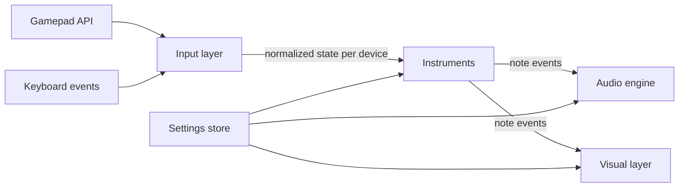

# Design – GarageBox - Music Sandbox

Status: milestones 1-5 implemented; decisions marked *provisional* wait for the owner's review. Requirement IDs (R…) refer to [requirements.md](requirements.md).

## 1. Overview

The app is a single static page. Every frame it reads all input devices, turns raw button and axis changes into musical events per instrument, sends those events to the audio engine, and draws them.



Each layer only talks to the next through small, plain data objects, so instruments can be tested without audio or graphics, and the visuals never need to know what kind of device produced a note.

## 2. File structure

```
README.md
docs/                      Requirements and design (not published)
tests/                     Logic test pages (not published)
src/                       The app; only this folder is published
  index.html
  css/
    style.css
  js/
    main.js                  App start-up, main loop, wiring
    input/
      gamepad-manager.js     Connect/disconnect, polling, edge detection
      detect.js              Controller type detection (R2.5)
      known-devices.js       VID:PID lists for guitars and drum kits
      mappings.js            Raw button/axis indexes -> logical controls
      keyboard-input.js      Keyboard events -> logical controls (R4c)
    instruments/
      instrument.js          Shared base: voice bookkeeping, event output
      guitar.js              Fret/strum logic (R4), also used for gamepad guitar/bass
      drums.js               Drum mapping and velocity (R4b)
      keys.js                Piano-style keyboard with sustain pedal (R4c)
      setup.js               Builds an instrument and its sound config from settings
    audio/
      audio-engine.js        AudioContext, master output, routing to sources
      effects.js             guitar effects chain: drive, cabinet, echo, reverb (R3.6)
      pluck-worklet.js       Karplus-Strong plucked string (AudioWorklet) (R3.4)
      pluck-source.js        Main-thread wrapper for the worklet
      bass-source.js         Generated bass sound (R3.4.1)
      midi-source.js         Wrapper around webaudio-tinysynth (R3.3)
      theory.js              Note names, scales, MIDI note numbers
    visual/
      lanes.js               Layout of lanes side by side (R5.3)
      star-power.js          Star power trigger and confetti/light effect (R5.5)
      highway-view.js        Highway with notes travelling away (R5.2, R5.4)
      simple-view.js         Panel with lit buttons and note names (R5.2)
      keyboard-view.js       On-screen computer keyboard (R4c.5, R4c.6)
    ui/
      start-screen.js        "Click to start" and "press any button" prompts
      settings-panel.js      Per-controller advanced settings (R2.9)
      debug-view.js          Raw input view covering one lane (9.1)
      menu-nav.js            Gamepad navigation of the menus (7.4)
    settings/
      store.js               Defaults, load/save in localStorage (R2.7)
    i18n/
      i18n.js                Loads language JSON files (R6.2)
  lang/
    common.json              Words that are the same in every language
    en.json
    sv.json
  vendor/
    webaudio-tinysynth/
      webaudio-tinysynth.js
      LICENSE
.github/workflows/
  pages.yml                Deploy to GitHub Pages (R7.3)
```

All app code lives in `src/` and is ES modules loaded with `<script type="module">` (R7.1). Tests in `tests/` import modules from `../src/`. For local testing the repository root is served with any static file server, e.g. `python3 -m http.server`, because ES modules and AudioWorklets do not load from `file://`.

## 3. Input layer

### 3.1 Gamepads

- `gamepad-manager.js` listens for `gamepadconnected` and `gamepaddisconnected` and keeps one `Device` object per `gamepad.index`.
- Polling runs once per animation frame with `navigator.getGamepads()`. For each device it compares the new button/axis values with the previous frame and produces edges: `pressed`, `released`, and analog `changed`.
- Detection (`detect.js`) runs once on connect and returns `guitar`, `drumKit` or `gamepad`, following R2.5: XInput type in the id, then VID:PID against `known-devices.js`, then keywords. A stored manual choice for the same `gamepad.id` always wins (R2.6, R2.7).
- `mappings.js` translates raw indexes into logical controls, so instruments never see raw indexes:
  - Guitar: `fret1`…`fret5`, `strumUp`, `strumDown`, `dpadLeft`, `dpadRight`, `whammy` (0..1), `tilt` (0..1), `start`, `back`. On the Xplorer the D-pad up/down *is* the strum bar (same raw buttons B12/B13), so there is no separate `dpadUp`/`dpadDown`; D-pad left/right (B14/B15 in `guitar-standard`, hat axis 6 in `guitar-xpad`) are only used to change values in the menus (7.4) and as two extra pads when the guitar is set to drums.
  - Analog controls also get an on/off ("pressed") state, used for display (the device information view and the outline of the control pills in the simple view), for the `pressed`/`released` edges and, for `tilt`, as the star power trigger (6, R5.5); no instrument plays notes on it. An analog control counts as pressed above 0.5 of its 0..1 range, except `tilt`, which counts as pressed only at 0.9 or more (raw axis −0.8 or lower on the Xplorer, where the axis falls when the neck is raised), so that ordinary playing angles do not show as pressed.
  - Gamepad: `faceA/B/X/Y`, `shoulderL/R`, `triggerL/R` (0..1), `dpadUp/Down/Left/Right`, `start`, `back`.
  - The guitar mapping has a variant for browsers that apply the W3C "standard" mapping (`guitar-standard`: Chrome on Windows via XInput, and Chrome on Linux, which reports the Xplorer as `STANDARD GAMEPAD`) and a raw Linux (xpad/evdev) variant (`guitar-xpad`), since the indexes differ. `guitar-standard` is confirmed with the real Xplorer on Chrome/Linux (see 9.1), including D-pad left/right; `guitar-xpad` is still a best guess.

### 3.2 Keyboard

- `keyboard-input.js` listens to `keydown`/`keyup` on `KeyboardEvent.code` (R4c.7) and ignores auto-repeat (`event.repeat`).
- It is only active when the keyboard instrument is enabled (R4c.2). While active it calls `preventDefault()` for `Space`, `Backspace`, `Alt` and all keys used for playing (R4c.8, R4c.10).
- It exposes the same kind of logical controls: `fret1`…`fret5`, `strum` (Backspace), `note:<code>`, `sustain` (Space), `octaveUp` (Shift), `octaveDown` (Alt).
- It is treated as one extra device in the lane list, shown last (`KeyboardDevice`, id `computer-keyboard`, with the same `controls`/`controlEdges` interface as a gamepad device). It has no debug view, since it has no raw buttons or axes.
- Keys typed into form fields (the settings panel's selects) and keys pressed together with Ctrl or Meta are left to the browser. When the window loses focus, all keys count as released, so no note hangs. The top bar controls give the focus back after a change so playing continues right away.

## 4. Instruments

An instrument receives the logical edges of one device each frame and emits note events. It also owns the bookkeeping of which notes are ringing.

### 4.1 Note events

```js
{ type: 'noteOn',  voiceId, midi, velocity, time }
{ type: 'noteOff', voiceId, fade, time }      // fade in seconds (R4.3.1)
{ type: 'bend',    semitones, time }          // whole instrument
{ type: 'volume',  gain, time }               // whole instrument
```

`voiceId` is unique per sounding note, so the audio engine and the highway can follow the same note from start to end (R5.4).

### 4.2 Guitar (`guitar.js`)

Per fret it keeps: `held` (button down) and the `voiceId` of its ringing note (or none). (An earlier draft also had `heldSinceStrum`; it turned out not to be needed, because R4.4 simply restarts the note on every strum.)

- Within one frame, fret edges are processed before strum edges, so pressing a fret and strumming in the same frame mutes the old note and plays a new one. Strum up and strum down in the same frame count as one strum.
- Strum (up or down edge): for every fret that is held, if it has a ringing note from a previous strum, stop that voice and start a new one (R4.4); otherwise start a new one. Frets that are not held are untouched and keep ringing (R4.6). Several held frets sound together as a chord (R4.8).
- Fret press-down: if that fret has a ringing note, send `noteOff` with the short fade (R4.3, R4.3.1).
- Fret release: nothing; the note keeps ringing and decays on its own (R4.2, R4.7).
- Notes come from `theory.js`: scale and root from settings, default E minor pentatonic, fret 1 to 5 = E3, G3, A3, B3, D4 (MIDI 52, 55, 57, 59, 62) (R4.9). Other keys are placed at most half an octave from E3 (B2-A#3), so changing the key never jumps by almost an octave. Scales with more than five notes play their first five notes; the blues scale (six notes) plays its first five. Bass is the same logic one octave lower (E2 = 40) with a bass sound (R2.10). The per-controller setting `octave` (−1 Low, 0 Middle = default, +1 High) shifts all fret notes by 12 semitones per step after the key and scale are applied, for guitar and bass alike (R4.13).
- Whammy and tilt are turned into `bend` and `volume` events (R4.5). Each of them has an assignment setting: pitch bend, volume or off. Both are first turned into a *deflection* 0..1: the whammy value as it is (0 = at rest), the tilt from 0 when the guitar is held flat or pointing down (tilt value 0.5 or less; the Xplorer rests at about 0.44) to 1 with the neck pointing straight up. Before that, the tilt value is smoothed (R4.5.1) with a time-based exponential moving average: each frame `smoothed += (raw − smoothed) × (1 − e^(−dt/τ))`, where `dt` is the time since the last frame and `τ` the smoothing time. This works the same at any frame rate, needs no buffer, and gives about the same delay as averaging the last 10 readings at 60 fps when `τ` is 80 ms. The setting `tiltSmoothing` is a number field in ms (0 = off, default 80, range 0–1000, step 10). The simple view's tilt pill shows the smoothed value; the debug view shows the raw axis.
  - Pitch bend: `semitones = deflection × bend range`. Default range −2 semitones (a whole tone down at full whammy, like a real whammy bar, which slackens the strings). The range is a number field in semitones (default −2, range −24 … +24, step 1; 0 = no bend).
  - Volume: `gain = 0.5 + 0.5 × deflection`, i.e. half volume at rest, full volume at full deflection (a volume swell). If both controls are set to the same target, bends add up and gains multiply.
  - *Provisional default (owner to review):* whammy = pitch bend (−2), tilt = volume swell. Tilting the neck up makes the guitar louder.
- Start opens (or closes again) the settings panel for this device (R4.10). Back stops all voices with the soft fade (R4.11).
- **Tap-to-play** (R2.13, 7.4): while this device's settings panel is open as a gamepad menu (opened with Start, not with the mouse), `setTapToPlay(true)` is on. A fret press then mutes that fret's ringing note (as R4.3) and plays its note at once, without a strum; releasing the fret stops that tapped note with the same mute fade. The strum bar does not reach the instrument while the menu is open (it navigates). When the panel closes, tapped notes still held ring on like strummed notes and normal strum playing applies again. A note that was strummed before the panel opened keeps ringing until its fret is pressed. Gamepads in guitar or bass mode tap with their fret buttons (A, B, Y, X, LB).
- On a regular gamepad in guitar mode, four face buttons plus one shoulder button are the frets and D-pad up/down is the strum bar (R2.10). The Xbox face button colors match the fret colors: A = green, B = red, Y = yellow, X = blue, LB = orange.

### 4.3 Drums (`drums.js`)

- Each logical button maps to a General MIDI drum note (channel 10) (R4b.1). Default mapping (`DEFAULT_DRUM_MAP` in `drums.js`):

  | Control | Sound | GM note |
  |---|---|---|
  | A / B / X / Y | kick, snare, closed hi-hat, low tom | 36, 38, 42, 45 |
  | LB / RB | crash, ride | 49, 51 |
  | LT / RT (velocity) | open hi-hat, high tom | 46, 50 |
  | D-pad up / down / left / right | hi-mid tom, low floor tom, hand clap, cowbell | 48, 41, 39, 56 |
  | Guitar controller set to drums: frets 1-5, strum up / down, D-pad left / right | kick, snare, closed hi-hat, low tom, crash; ride, open hi-hat; hand clap, cowbell | 36, 38, 42, 45, 49; 51, 46; 39, 56 |

  Each control's sound can be changed (or set to none) in the settings (R4b.2); the list offers 27 GM drum sounds.
- Digital buttons use a fixed velocity (100). Triggers fire when they pass 0.2, with velocity 30-127 from how far they were pressed at that moment, and re-arm below 0.1 (R4b.1).
- Start opens the settings panel, as on the guitar.
- While the settings panel is open as a gamepad menu, pads keep playing, except pads on the D-pad (or a guitar's strum bar and D-pad left/right) and Back, which navigate the menu instead (7.4). In a panel opened with the mouse all pads play.
- Drum notes are one-shot: `noteOn` only; the sound ends by itself.

### 4.4 Keys (`keys.js`)

- Maps `KeyboardEvent.code` to MIDI notes with the musical typing layout (R4c.4): home row `A`…`L` = C4…D5, `W E T Y U O P` = C#4, D#4, F#4, G#4, A#4, C#5, D#5, bottom row `Z`…`M` = C3…B3; plus the octave offset from Shift/Alt at the moment the key is pressed (R4c.8). Shift and Alt together cancel out.
- Key up sends `noteOff` with a short release, unless the sustain pedal is down; then the note is marked as sustained and stopped when the pedal is released (R4c.9, R4c.10).
- A key pressed again while its note is still sustained restarts the note.
- The `1`–`5` and Backspace keys are passed to an internal guitar instance (R4c.3). Its events carry `part: 'guitar'` and go to a second audio channel with the plucked string sound; it uses the keyboard's key and scale settings.

## 5. Audio engine

- One `AudioContext` with `latencyHint: 'interactive'`. Browsers only allow audio to start after a click or key press, and a gamepad button does not count. The start screen therefore asks for one click or key press before anything else (see 7.1).
- Each instrument gets its own gain node (for `volume` events) feeding a master gain and a light limiter (`DynamicsCompressorNode`) to avoid clipping when many notes ring.
- Two source types, chosen per instrument (R3.5):
  - **Pluck source** (`pluck-worklet.js`): an AudioWorklet that runs one Karplus-Strong string per voice (up to 24 per instrument; the oldest is dropped beyond that). A noteOn writes one period of low-passed noise into a delay line; each sample the line is fed back through a two-tap low-pass and a loop gain chosen so the note falls 60 dB in the *ring time* (decay). The delay line is read with linear interpolation, so pitch bend changes the delay length smoothly (smoothed over about 10 ms); `noteOff` applies a linear gain ramp of `fade` seconds. Ring time (number field in seconds: default 4 s, range 0.5–30 s, step 0.5) and tone (drop-down: dark/warm/normal/bright) are settings. When the bass is set to the pluck source it uses the same string with 1.5× the ring time and a darker tone. The worklet output passes a DC blocker and a soft clip (`tanh`).
  - **Bass source** (`bass-source.js`, R3.4.1): a small subtractive synth built from normal Web Audio nodes on the main thread (no worklet). Each voice (up to 24 per instrument; the oldest is dropped beyond that) is a sawtooth oscillator plus a sine oscillator one octave lower at about 50 % level, into a low-pass `BiquadFilterNode` (Q about 0.7) and a gain node.
    - Thump: the filter cutoff starts at about 1200 Hz and falls exponentially to its resting value in about 0.25 s, so the note starts with a short, soft attack like a finger on a string. The resting cutoff comes from the tone setting: dark 250 Hz, warm 400 Hz, normal 600 Hz, bright 900 Hz.
    - Level: attack 5 ms, then an exponential decay that falls 60 dB in the ring time (same setting and choices as the guitar, default 6 s for the bass). `noteOff` applies the linear `fade` ramp (R4.3.1), then the oscillators are stopped and disconnected.
    - Bend: `semitones × 100` on both oscillators' `detune`, smoothed over about 10 ms with `setTargetAtTime`. The exact numbers are starting points to be tuned by ear.
  - **MIDI source** (`midi-source.js`): wraps webaudio-tinysynth, connected into the instrument's gain node. `bend` becomes a pitch-bend message (the bend range is set to the instrument's bend range, so semitones map 1:1) and `noteOff` becomes a note-off; the fade time is not used, the program's own release applies. Each instrument gets its own synth instance (on MIDI channel 1, or 10 for drums), because one shared instance has only one output and could not feed separate gain nodes; instances are pooled and reused. The library is a classic script (it sets `window.WebAudioTinySynth`), so it is loaded on first use with a `<script>` element from `vendor/`; a small subclass switches off its own AudioContext (`internalcontext`) and hands it the shared one with `setAudioContext(context, destination)`. The vendored file is unmodified.
- **Effects** (`effects.js`, R3.6): an optional chain per instrument, placed after the instrument's gain node and before the master gain, so `volume` events (tilt, whammy) change loudness without changing how much it distorts. Setting `effect`: `clean` (default; the chain is bypassed and nothing extra is connected), `crunch` or `epic`. The chain, in order:
  - Drive: a gain stage into a `WaveShaperNode` with a `tanh` curve and `oversample: '4x'` (avoids harsh aliasing). Crunch drive about ×4, Epic about ×20.
  - Amplifier cabinet: a high-pass at 80 Hz, a gentle peak around 1.5 kHz and a low-pass around 5 kHz (Crunch) or 4.5 kHz (Epic), so the distortion sounds warm instead of fizzy.
  - Echo (Epic only): a `DelayNode` of 375 ms with feedback 0.3 through a low-pass at 3 kHz, mixed in at about 25 %.
  - Reverb: a `ConvolverNode` with an impulse response generated at start-up from decaying noise (no recordings), about 0.8 s for Crunch and 3 s for Epic, mixed in at about 15 % and 30 %.
  - Level match: an output gain per preset so Crunch and Epic are about as loud as Clean; the master limiter (above) still catches peaks.
  Switching preset rebuilds or reconnects the chain without cutting ringing notes; the exact numbers are starting points to be tuned by ear.
- Default sources: guitar uses the pluck source, bass the bass source (the bass can also choose the pluck or MIDI source); drums and keyboard use the MIDI source (drum kit and Acoustic Grand Piano) (R3.5, R4c.11). With the MIDI source the default programs are Electric Guitar (clean) for guitar and Electric Bass (finger) for bass. Drums only have the MIDI drum kit; the keyboard can also use the plucked string.

## 6. Visual layer

- Drawing uses one `<canvas>` with the 2D API for all lanes, redrawn every animation frame. Settings and prompts are normal HTML on top.
- `lanes.js` splits the width into one lane per device, side by side, each with its own color and the controller number above it (R5.3, R5.3.1). The keyboard lane uses the label "Keyboard".
- **Highway view** (`highway-view.js`): a lane is drawn in perspective with five columns. A `noteOn` creates a note mark at the near end; it moves away into the distance at a constant speed. While the voice rings, a trail connects the note mark to the near end, with opacity following the voice's current level, and ends when the voice stops (R5.2, R5.4). Notes older than the visible length are dropped.
  - A note travels the whole road in 6 s (longer road so notes stay visible longer; was 3 s). The level of each note is sampled about 40 times a second, so every part of the trail keeps the opacity the note had when that part was played (the trail fades along its length as the note decays). When the voice is silent or stopped, the trail's near end detaches and travels away too.
  - Columns: the five frets (in the fret colors) on guitar and bass, one column per drum pad on drums (one-shot gems without a trail, sized by velocity), and pitch from left (C2) to right (G6) on the keyboard lane (piano notes white, the keys 1-5 guitar in fret colors).
  - The near end shows what the player presses: the fret buttons with their note names (guitar, bass), small labels of the drum pads that light up on a hit (drums), or the on-screen keyboard (keyboard lane).
  - Cross lines move away with the notes every half second, so the motion is visible even without notes.
- **Simple view** (`simple-view.js`): the lane shows the device's buttons, lit while pressed, and the names of ringing notes (R5.1, R5.2). Guitar and bass: the five fret buttons with each fret's note name below it, glowing while their note rings; the names of all ringing notes; pills for the other controls (strum, whammy with its value 0.00-1.00, tilt, Start, Back). Analog controls fill smoothly and are never shown fully lit by the press threshold. Raw buttons and axes are only shown in the debug view (9.1).
- **Star power** (`star-power.js`, R5.5): per guitar lane (a device with both a whammy axis and a tilt axis, whatever instrument it plays).
  - Trigger: each frame, star power starts when it is not active, the `tilt` control is pressed (its on/off state from 3.1: 0.9 or more, raw axis −0.8 or lower on the Xplorer) and whammy deflection ≥ 0.95 in the same frame. Assignments (pitch, volume, off) do not matter, and star power works even when the tilt's sound effect is turned off.
  - Staying on: while active and the `tilt` control is pressed, star power stays on and no countdown runs; the whammy is not needed. When `tilt` is released, an 8 s countdown starts; if `tilt` is pressed again before it runs out, the countdown is cancelled and starts again from 8 s the next time it is released. When the countdown reaches 0, star power ends. The countdown is internal only and never drawn.
  - Restart: after it has ended, it starts again only through the start trigger above.
  - Events: the guitar instrument emits `starPower` events (`{ type: 'starPower', on: true|false, time }`) to the visual layer only; the audio engine ignores them.
  - Confetti: a particle layer drawn on the same canvas, over the lane only: about 150 pieces spawned in the first 1.5 s at the top of the lane, small rectangles in the five fret colors plus white, falling with gravity, a little sideways drift and spin, new pieces keep spawning at a lower rate while star power lasts, and stop when it ends. Pieces outside the lane are dropped. With `prefers-reduced-motion: reduce`, only about 30 pieces fall, slowly.
  - Light: the lane's color is replaced by a bright blue-white glow (GH-style star power) that fades in over 0.3 s and back to the lane color over 1 s after star power ends; in the highway view the road edges, cross lines and note trails take the glow color; in the simple view the lane background and the fret frames do.
  - Setting `starPower` (checkbox, default on) in the per-device panel, shown only on lanes that can trigger it.
- The visual style is a global setting (top bar "View": Highway, the default, or Simple); per-lane override can come later if needed.
- `keyboard-view.js` draws the on-screen keyboard when the keyboard instrument is enabled, with note names on the playing keys and lit keys while pressed (R4c.5, R4c.6). It is drawn at the bottom of the keyboard lane in both visual styles, as five rows: `1`-`5` in the fret colors with their fret notes and Backspace (Strum); the black-key row; the home row; Shift (Octave +) and the bottom row; Alt (Octave −) and Space (Sustain). The note names follow Shift/Alt while they are held. Key letters are the US names of the physical keys.
- Drums in the simple view: one pad per mapped control with the drum's name and the control's name, flashing on each hit with a brightness from the velocity.
- To show fading trails, the audio engine keeps a simple per-voice level estimate (envelope model, `VoiceTracker` in `audio-engine.js`) on the main thread instead of reading audio data back: pluck and bass voices decay exponentially with the ring time, MIDI melodic voices decay slowly while held and release in 0.3 s, drum hits fade within 0.6 s, a `noteOff` adds a linear fade, and the instrument's current volume is applied. Voices below 2 % are dropped.

## 7. User interface

### 7.1 Start screen

1. "Click or press a key to start" (unlocks audio). The card has a **Start** button that carries the gamepad cursor when a controller is connected; Start on any controller starts too (7.4). Browsers do not count a gamepad button as a user gesture, so after a controller start the app waits up to 0.5 s for the AudioContext to run; if it is still blocked, the screen stays and says that one click or key press is needed (the click still works as before).
2. "Press any button on a controller" until at least one gamepad is seen (R2.8). The keyboard instrument can be turned on here too, with a "Play with the computer keyboard instead" button; it is also a checkbox in the top bar.
3. New controllers can be connected at any time; a lane is added when they appear and removed when they disconnect.

### 7.2 Settings panel

- A global part: visual style, keyboard instrument on/off, note names (R6.3), language. The international note names are a list of 12 strings `notes.names` in `lang/common.json`; each language file may define its own list `notes.names` (Swedish: the same list with `H` instead of `B`; English: none, so it falls back to the common list). The "Note names" select is only shown when the current language's list differs from the common one; its options are labelled with a short example (e.g. "C D E F G A B" and "C D E F G A H"). The saved choice (`international` or `language`, default `international`) is kept when switching to a language without its own list, but then has no effect. `theory.js` takes the active list instead of a hard-coded `NOTE_NAMES`. These live in the top bar, so there is no separate global panel.
- A per-device part (R2.9), opened from a small button above each lane or with Start on the guitar: instrument type, sound source, MIDI program, key and scale, whammy/tilt assignment, tilt smoothing, effect, fade time, decay, button-to-sound mapping for drums, and a button that opens the device's debug view (9.1).
  - Fields are only shown where they apply: sound source for instruments with more than one source (not drums); MIDI program when the MIDI source is used ("Automatic" = the instrument's default program); key, scale and mute fade-out for guitar, bass and the keyboard's guitar keys; whammy, tilt, tilt smoothing and bend range only on a controller that has a whammy bar or tilt sensor (bend range only when one of them bends); ring time and tone for the plucked string; effect (Clean, Crunch, Epic) for every instrument except drums (R3.6); one drum sound per control for drums.
  - **Number fields** (R2.9.1): numeric settings use `<input type="number">` with `min`, `max` and `step`, and a unit after the field (ms, s, semitones). The value is applied on `change` (typing, then Enter or leaving the field) and when stepped with the controller; values outside the range are clamped to the nearest limit and an empty or invalid entry restores the previous value. Fields and limits:
    - Mute fade-out (`fadeMs`): default 1000 ms, range 10–10000 ms, step 50 (R4.3.1).
    - Ring time (`decay`): default 4 s (bass 6 s), range 0.5–30 s, step 0.5.
    - Tilt smoothing (`tiltSmoothing`): default 80 ms, range 0–1000 ms, step 10; 0 = off.
    - Bend range: default −2 semitones, range −24 … +24, step 1; 0 = no bend.
    Stored values from the old drop-down lists are already numbers in these ranges, so they keep working.
  - Whammy and tilt each choose *Pitch bend*, *Volume* or *Off*, with a short plain-language hint below that explains what the current choice does. Bend range is a number field (see 4.2).
  - "Reset to defaults" removes all stored settings of the device. The keyboard's panel has no instrument choice (always Keys) and no debug view.
- Every setting has a default; the panel is never needed to start playing.
- A gamepad lane's panel shows a short hint at the bottom: the controller keys in a gamepad menu, or, when opened with the mouse, a tip that opening it with Start lets the controller operate it (7.4).

### 7.4 Gamepad menu navigation

Menus can be driven with the controller (R2.12). Navigation is only active while a menu is open; during normal play nothing changes.

- **Gamepad menu or plain panel:** how a lane's settings panel was opened decides what the controller does (R2.14).
  - Opened with **Start** on the controller, the panel is a *gamepad menu* (`gamepadMenu: true`): the controller navigates it as described below and frets tap-to-play.
  - Opened with the **mouse** (the ⚙ button, by click or keyboard), it is a plain panel: no gamepad cursor, no navigation, no tap-to-play. The instrument gets every edge exactly as without a panel (strum strums, Back mutes, all drum pads play), so a mouse user can change settings while playing. Settings changes apply immediately in both cases (as before, through the settings store). Start on the controller turns the open plain panel into a gamepad menu in place (R2.14), with the cursor on the first field.
  - The device information view opened from the panel inherits the panel's mode.
  - The start screen is always driven by the controllers.
- **Which menus:** the start screen (step 1, driven by any controller, since it is not tied to a lane), a lane's settings panel and a lane's device information (debug) view, when they are gamepad menus. A lane's panel or view is only driven by that lane's controller; several players can each have their own panel open at once. The computer keyboard lane has no gamepad navigation.
- **Intents** (`MenuInput` in `menu-nav.js`, pure): logical controls become `up` (`dpadUp`, `strumUp`), `down` (`dpadDown`, `strumDown`), `left` (`dpadLeft`), `right` (`dpadRight`), `back` and `start`. They are edge-triggered; directions held down repeat after 400 ms, then every 120 ms. Two names on the same raw button in one frame give one intent. The state is reset whenever no menu is open, so a direction held before the menu opened does not repeat.
- **Controls taken from the instrument:** while a lane's menu is open, its directions (D-pad, strum bar) and Back only navigate and are filtered out before the instrument sees the edges, so a guitar does not strum, Back does not mute, and drums do not play the D-pad pads. Start is also taken from the instrument while a gamepad menu is open: it activates the control under the cursor (R2.12). With no menu open, Start goes to the instrument, which opens the settings panel (R4.10); with a plain (mouse-opened) panel open, it turns that panel into a gamepad menu. While the start screen is up, directions, Back and Start of every controller go to the start screen only.
- **Guitar rotation** (R2.12): when the menu belongs to a controller detected as a guitar (detected type `guitar`, e.g. the Xplorer, whatever instrument it is set to play; not a regular gamepad in guitar/bass mode), the intents are turned 90 degrees clockwise before they reach the cursor: `right` → `down` (next control), `left` → `up` (previous control), `up` → `right` (value forwards), `down` → `left` (value backwards). On the Xplorer that means D-pad right (B15) = next, left (B14) = previous, strum up / D-pad up (B12) = value forwards, strum down / D-pad down (B13) = value backwards. `back` and `start` are unchanged. It applies to the lane's settings panel and device information view; the start screen only needs Start, so it is not rotated. The controller hint at the bottom of the panel uses guitar wording for these directions. The direction was chosen by trying both on the real guitar (2026-10-22).
- **Gamepad cursor** (`MenuNavigator`, DOM): a highlight in the lane color (CSS class `gamepad-focus`, a thick outline; the field label is colored too), separate from the browser focus. The browser focus is not moved, so several lanes can each have their own cursor, the computer keyboard keeps playing (it ignores keys typed into form fields) and mouse use is unchanged. The cursor follows a control by its `data-key` (or class) when the panel re-renders after a setting change.
  - Up/down move through the menu's visible, enabled `select`, `input` and `button` elements in document order (the field grid is read row by row), wrapping at both ends. The settings panel starts on its first field, the device information view on its close button.
  - Left/right change the value: a select cycles its options backwards/forwards (wrapping) and fires `change`, a number input steps by its `step` within `min`/`max` (no wrapping) and fires `change`. On buttons and checkboxes, left/right do nothing.
  - Start activates the control under the cursor: it presses a button (e.g. *Device information*, *Reset to defaults*, close, *Copy report*, the start screen's *Start*) or toggles a checkbox; on a select or number input it does nothing. One action per button: Start never closes a menu.
  - Back closes the open menu; in the device information view it closes the view and returns to the settings panel.
- **Focus when opened by gamepad:** a panel opened with Start does not move the browser focus to its first field, and closing it only gives the focus back to the lane's settings button if the focus was inside the panel. The same applies to the device information view opened from the panel with the gamepad. Mouse and keyboard opening work as before.
- **Tap-to-play:** while a guitar or bass lane's settings panel is open as a gamepad menu, frets play without strumming (4.2), so sounds and keys can be tried while changing them. Drums keep playing on press (4.3).

## 8. Settings, storage and language

- `store.js` keeps defaults in one object and saves user changes in `localStorage`, global settings under one key and per-device settings keyed per R2.7: key `id:<gamepad.id>` when the id is non-empty and unique among connected devices, else `slot:<type>:<gamepad.index + 1>` (e.g. `slot:guitar:1`). The key is chosen on connect; when a second device with the same id connects, both use slot keys, and the slot key starts from the settings saved under the shared id key if it has none of its own. Play state that changes the sound (e.g. a locked pitch offset) is saved under the same key as the settings. Unknown or missing values fall back to defaults, so new settings never break old saved data.
- `i18n.js` loads `lang/common.json` plus `lang/<lang>.json`, chosen from the setting or `navigator.language`, with English as fallback (R6.2). UI code only uses text keys, never literal strings.

## 9. Testing

### 9.1 Hardware check with the Xplorer

Before the guitar mapping is final, we need to see the raw input. Each device's advanced settings panel has a **Device information** button (internally called the debug view; the UI name was changed from "Debug view" because the view shows information about a controller, not only for fixing problems). It opens a debug view that covers exactly that device's lane (e.g. half the screen with two controllers connected), so other lanes keep working. It shows `gamepad.id`, the detected type, the parsed VID:PID, and the live value of every raw button and axis, plus the logical controls they map to. A close button returns to the normal lane. With it we confirm on Chrome/Linux:

- the id string and VID:PID,
- the button indexes of the five frets, strum up/down, Start and Back,
- the whammy axis range and whether tilt is gradual or on/off (R4.5).

**Result (real Xplorer, Chrome 155 on Linux):** `gamepad.id` is `RedOctane Inc(c)2006  Guitar Hero X-plorer   (STANDARD GAMEPAD Vendor: 1430 Product: 4748)`, browser mapping `standard`, 17 buttons and 4 axes, so the app uses `guitar-standard`. Frets B0, B1, B3, B2, B4 (green, red, yellow, blue, orange) are confirmed; strum up/down B12/B13, Start B9 and Back B8 are confirmed by the owner. D-pad left/right are B14/B15 (confirmed by the owner). Whammy is axis 2, resting at −1 (mapped to 0..1). Tilt is axis 3 and gradual, resting at about +0.12 when held flat; it is inverted in the mapping (`from: 1, to: -1`), so pointing the neck up raises the value.

### 9.2 Logic tests

Instrument logic is pure (logical edges in, note events out), so `guitar.js`, `drums.js` and `keys.js` get small browser-run test pages under `tests/` that feed scripted edge sequences and check the events, e.g. "strum twice without release gives two noteOn and one noteOff". `tests/` is excluded from deployment.

Pages (open `tests/index.html` through a local server; each page's title starts with PASS or FAIL, so a headless browser can read the result):

- `detect.test.html`: controller detection and mappings (milestone 1).
- `guitar.test.html`: frets, strum, restrum, mute, chords, Back/Start, key and scale, bass octave, octave setting (R4.13), gamepad guitar mode, whammy/tilt assignment, tilt smoothing (R4.5.1), tap-to-play, number-field settings (R2.9.1: defaults including mute fade-out 1000 ms, clamping, invalid entry restores the previous value).
- `menu-nav.test.html`: menu intents and key repeat, number fields stepped with the controller (step, clamping at min/max, no wrap), the guitar rotation (R2.12: on a guitar right/left move and up/down change the value; a regular gamepad, also in guitar mode, is not rotated), the gamepad cursor (move, wrap, change values, press buttons, re-render) and the settings panel's gamepad navigation, including that a mouse-opened panel has none (7.4).
- `drums.test.html`: default mapping, one-shot notes, trigger threshold and velocity, custom mapping, guitar controller as drums.
- `effects.test.html`: effect presets build the expected chain (drive, cabinet, echo only for Epic, reverb), Clean adds nothing, the setting is offered for every instrument except drums, and switching preset keeps ringing notes (R3.6).
- `keys.test.html`: musical typing layout, piano behavior, octave shift, sustain pedal, guitar keys, and `KeyboardDevice` (auto-repeat, Ctrl, form fields, release all).
- `star-power.test.html`: start condition (`tilt` pressed, i.e. mapped ≥ 0.9, and whammy ≥ 0.95 in the same frame), only on devices with whammy and tilt, independent of assignments; stays on while `tilt` is pressed even with whammy released; ends 8 s after `tilt` is released; pressing `tilt` again before the end cancels the countdown and releasing again restarts it from 8 s; restart after end needs the start trigger again; no countdown is drawn; the setting turns it off; no audio event.
- `bass.test.html` (extra): renders the bass source in an `OfflineAudioContext` and checks level, pitch (fundamental), the thump (more high content at the start than after 0.3 s), natural decay with the ring time, mute fade, bend, the voice limit, and that the bass defaults to this source.
- `pluck.test.html` (extra): renders the Karplus-Strong worklet in an `OfflineAudioContext` and checks level, pitch, natural decay, mute fade, bend and clipping.

`tests/test-runner.js` is the shared mini runner (`check`, `finish`) of the new pages.

## 10. Deployment

`.github/workflows/pages.yml` runs on pushes to the main branch. It copies the contents of `src/` into a `_site` folder with plain shell commands, then publishes it with the official `actions/upload-pages-artifact` and `actions/deploy-pages` actions. No Node.js build step is involved (R7.3).

## 11. Design questions (closed)

- ~~Default assignment of whammy and tilt to pitch and volume (R4.5), decided after the hardware check.~~ **Decided (provisional, owner to review):** the Xplorer's tilt is gradual, so both controls are usable. Whammy = pitch bend, −2 semitones at full press (the note goes down, like a real whammy bar); tilt = volume swell, half volume held flat, full volume with the neck pointing up. Both assignments (pitch bend, volume, off) and the bend range are per-device settings (see 4.2, 7.2).
- ~~Exact Xplorer button and axis indexes on Chrome/Linux (9.1).~~ **Confirmed** with the real Xplorer on Chrome 155/Linux, see 9.1.

## 12. Milestones

1. **Input and debug.** Start screen (7.1), gamepad connect/disconnect and polling (3.1), controller type detection (R2.5), lanes side by side with controller numbers (R5.3, R5.3.1), a minimal settings panel per device with the debug view (9.1), settings store and i18n skeleton (8), GitHub Pages workflow (10). Goal: connect the Xplorer and read its real id, buttons and axes on Chrome/Linux.
2. **Guitar sound.** Final guitar mapping from the milestone 1 findings, guitar logic (4.2), audio engine with the pluck source (5), simple view (6).
3. **More instruments.** Drums and MIDI source (4.3, 5), gamepad guitar/bass modes (R2.10), keyboard instrument and on-screen keyboard (3.2, 4.4).
4. **Highway and settings.** Highway view with sustain trails (R5.2, R5.4), full advanced settings (7.2), whammy/tilt assignment (R4.5).
5. **Tests.** Logic test pages (9.2).

